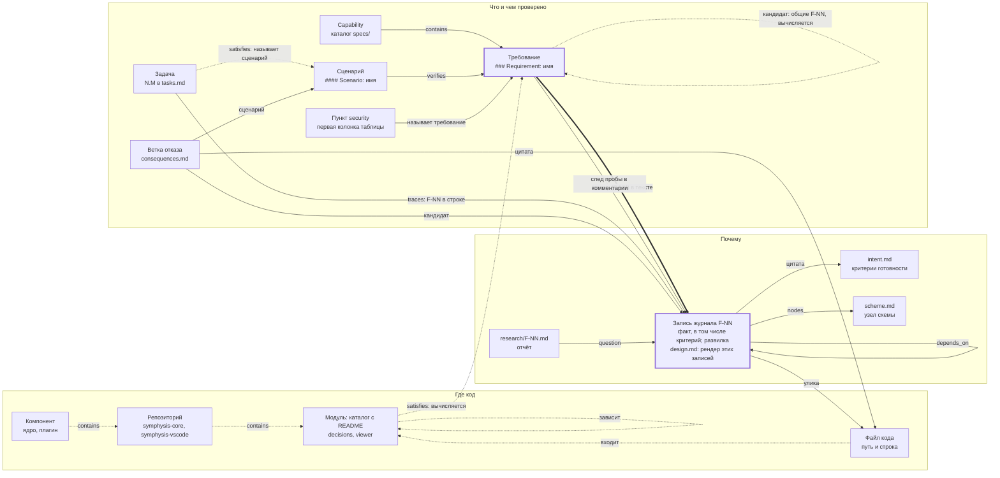
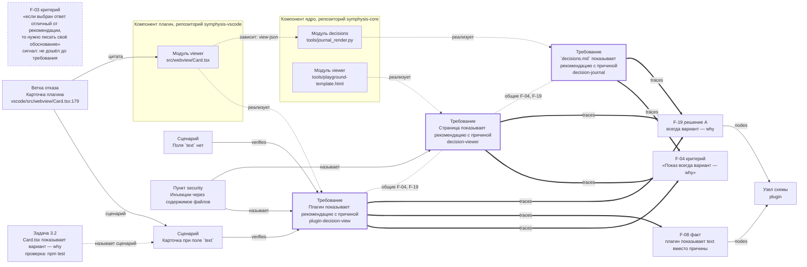
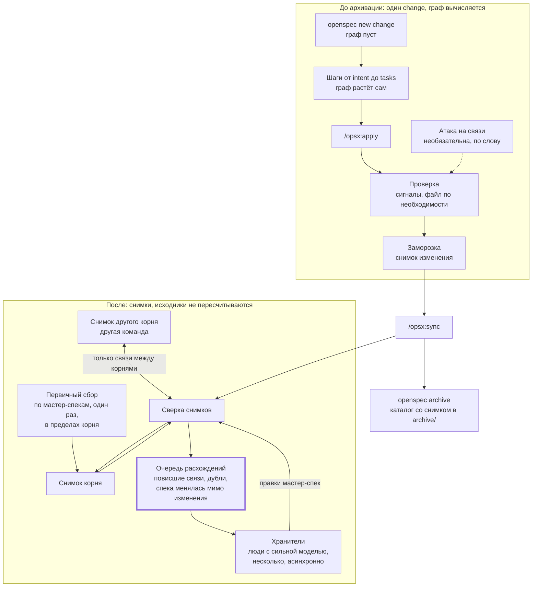
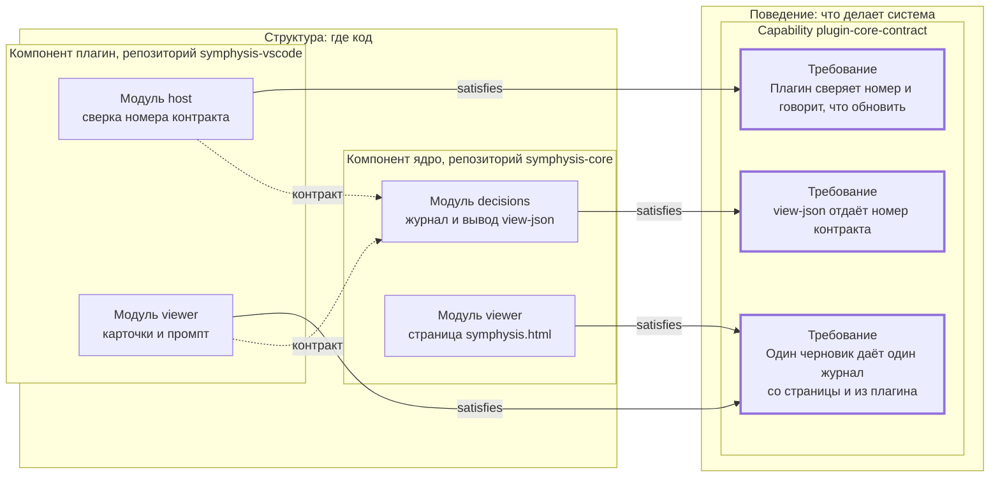
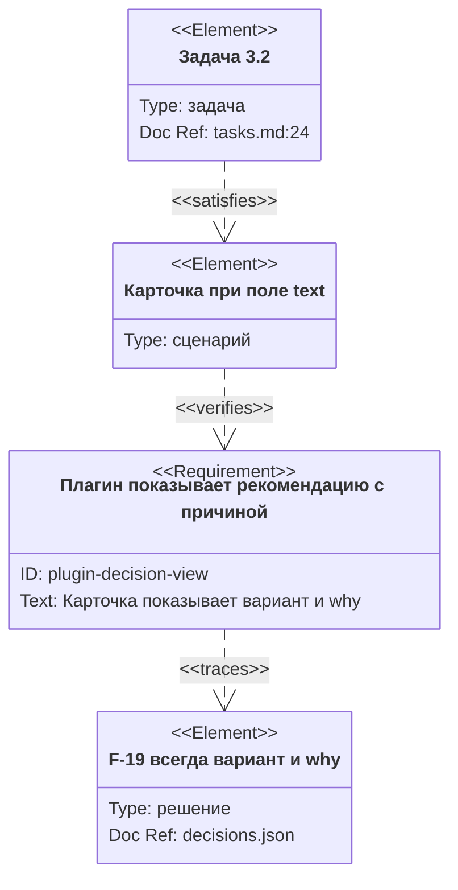

# Граф трассируемости изменений symphysis

## Рамка и статус

Переписано 2026-11-04 со сверкой по репозитории symphysis: прежняя версия была концепцией, схема и форк при ней не читались. Слово владельца: «первая часть этой сессии будет посвящена тому, чтобы сформировать решение с учетом текущей реализации symphysis, а детали уже дальше будем отрабатывать на стандартных кругах брейншторма».

Вторая редакция, 2026-11-05: внесены комментарии владельца к первой, 13 штук. Он читал сверху вниз и не учитывал написанное ниже, поэтому часть его слов сведена с текстом ниже, а не дописана рядом. В тот же день внесены его ответы на четыре вопроса к этой редакции: определения, `openspec validate`, третий эталон, Р19.

Это ещё не изменение OpenSpec. Решено только то, что стоит в разделе «Решения владельца». Остальное предложено Claude и пойдёт в журнал развилками.

Цифры взяты только из изменений внутри symphysis (Т12): 7 архивных изменений с требованиями, 188 требований, 251 задача, а также 168 требований мастер-спек. Считал разовым скриптом по совпадению строк, поэтому находка значит «ссылка есть», а не «ссылка верна по смыслу». Новые замеры идут на двух эталонных клонах (Т13, раздел «Эталонные изменения»).

## Коротко

1. **До архивации граф вычисляется** из файлов изменения. Он существует с первого шага и растёт сам, потому что растут артефакты. Если нужно, его можно собрать в файл, проверить и атаковать связи. Напрямую граф не правится, только через файлы изменения (Т14).
2. **Архивация замораживает его снимком** рядом с изменением.
3. **После архивации работает сверка снимков.** Единственное известное исключение: первый снимок корня собирается один раз полным проходом по мастер-спекам.
4. **Почти все связи уже лежат в артефактах.** Новых шагов не нужно. Нужно закрепить два соглашения, которые уже соблюдаются без правила: задача называет сценарий, требование называет запись журнала.
5. **Проверки остаются сигналами и выводятся отчётом.** По отчёту человек решает, реализовать требование или принять дыру (Т15). Смысл связей проверяет необязательная атака.
6. **`openspec validate` связей почти не видит, а архив зовёт его сам.** Решено: наша команда сама запускает его и выводит всё одним отчётом, форк не меняется (Т16, вариант D).

## Проблема

В сложных спецификациях не видно, что с чем связано, почему, каким сценарием проверяется и есть ли связь между требованиями. Узнать это можно, только прочитав всё или спросив модель, и оба пути дают неточный текст.

Граф отличается от схемы решения назначением, а не нотацией:

|  | `scheme.md` | Граф трассируемости |
| --- | --- | --- |
| Зачем | смотреть на концептуальную модель процесса, пока человек думает над развилками | снимок спроектированной системы: требования, их связи, решения, задачи, security |
| Кто пишет | агент в первом круге брейншторма и человек руками | собирается из артефактов, руками не правится |
| Статус | иллюстрация вне журнала | производный артефакт с проверкой, как `decisions.md` |
| Вид | `flowchart` | `requirementDiagram` или flowchart по требованиям |

Схема с графом связаны: записи журнала уже ссылаются на её узлы полем `nodes`. Поэтому от узла схемы можно дойти до записей, требований и задач.

## Решения владельца

Нумерация Т1–Т21 своя, чтобы не путать с решениями Р1–Р21 плагина VS Code.

- **Т1. Граф это снимок, схема это картинка.** «requirement diagram это snapshot текущего состояния, а scheme лишь удобная картинка».
- **Т2. Граф живёт с изменением.** Создаётся вместе с change, обновляется на каждом шаге, валидируется перед архивацией. После архивации связывается с мастер-спецификацией. «при создании change надо создавать его граф и постепенно наполнять». Форму уточняет Т9: создавать файл не нужно, граф вычисляется.
- **Т3. Проверка трассируемости не жёсткая.** Это необязательная атака: она задерживает выпуск функциональности, а выбор между быстрым и качественным результатом делает человек. «его должна делать не система, а человек».
- **Т4. Скрипты уменьшают работу модели, но не заменяют её силу.** «скрипты не могут компенсировать разницы, но могут уменьшить количество операций». Всё прочее думает человек, по регламенту, а не как придётся.
- **Т5. Мастер-спеку проверяют хранители, асинхронно.** «Хранители это методологическая часть процесса и объявлена здесь ради понимания общей картины. Зачем нужны хранители и кто это? Хранители знаний это люди, которые отвечают за мастер-спецификации и корректность связей в них» (2026-11-05). Хранителей может быть много, главное, чтобы они делали свою работу. Очередь конфликтов приятнее, чем ожидание проверки.
- **Т6. У хранителя сильная модель.** «Так как выполнение проверки мастер-спецификаций на межрепозиторном уровне при наличии множества changes это ответственная и тяжелая задача то поручать её слабой модели нельзя, поэтому и указано, что у хранителя должен быть доступ к хорошим моделям» (2026-11-05). deepseek-v4-pro достаточно, если нет последнего Opus.
- **Т7. Векторизация по необходимости.** Склонность: «возможно это оверхед и можно обойтись например мета слоем данных». Уточнение 2026-11-05: «Векторизация потребует отдельного хранилища и процесса и если конструкция графа, ровно как и объявление связей в артефактах, будут построены качественно, с возможностью расширения, то мы сможем подключить векторизацию по необходимости».
- **Т8. Компоненты и модули как вторая ось.** «Модуль это библиотека или микросервис, который отвечает за определённую доменную область», модуль привязан к компоненту. Capability не обязана лежать внутри одного модуля. Прежняя запись цитировала только согласие, а не то, с чем он согласился: «Решения владельца без контекста и "полностью согласен" вводят в заблуждение». Сами доводы дословно стоят в разделе «Компоненты и модули». «Доводы обсуждаемы, так как их составление вырвано из контекста и может отличаться от конструкции symphysis» (2026-11-05).
- **Т9. Граница — архивация, 2026-11-04.** «Да, граница архивация». До неё: «вычислении графа до момента архивации в рамках одного change -- то я согласен, он вычисляется, и если нужно его можно собрать в файл, провалидировать, провести атаку на связи». После неё: «вычисление может быть только в рамках сверки одного снапшота графа с другим».
- **Т10. Первичный сбор, 2026-11-04.** «Да, допускаю. Также допускаю, что могут быть и другие ограничения или требуемые исключения, которые на данном ходу мы еще не выявили. Но на текущий момент -- сверка + сбор по мастер-спекам».
- **Т11. Доступ есть, архивация — наш механизм, 2026-11-04.** «на практике же у пользователя symphysis есть доступ к репозиториям кодовой базы, других команд, клонам, разным веткам -- так как это необходимо для сбора информации, иначе откуда её брать? Но архивация change артефактов это удобный механизм, который мы переиспользуем у openspec, добавив по необходимости свои процедуры и проверки».
- **Т12. Какие цифры считать, 2026-11-04.** «разборы прошлых замеров, которые выполнялись для проверки качества составления, а не связности документов -- нам дадут плохие цифры. ближе к реальности те, что уже созданы внутри symphysis/».
- **Т13. Эталонные изменения, 2026-11-05.** «А вот разборы мы можем себе обеспечить. Возьмем два change: recommendation-why как небольшой и decision-scheme, как средний размер change, сохраним их клоны в момент последнего коммита перед архивацией, и будем ориентироватья на них, в случае необходимости получения замеров». Третий эталон: на предложение взять `step-help` как средний со всеми артефактами, потому что у `decision-scheme` нет `consequences.md` и `edge-probe.md`, ответ «Давай добавим клон step-help, это хороший выбор» (2026-11-05).
- **Т14. Граф правится только через файлы изменения, 2026-11-05.** «И это верный подход. В противном случае, если граф можно модифицировать и дополнять напрямую, а не через файлы изменения -- получится расхождение в логике сбора, конфликты, чего нужно избегать».
- **Т15. Сигналы идут отчётом, решает человек, 2026-11-05.** «Да, дырой в работе не оказался, задача реализована. Но некоторые нюансы тихо упущены, хотя человек их прочел и думал, что они будут учтены в реализации. Но так как сигналы удобно выводить отчетом, то можно увидеть такие сигналы и решить нужно ли реализовывать требования, или дыра приемлема».
- **Т16. `openspec validate`, 2026-11-05.** «в ванильном openspec таких связей меньше, а сами связи менее явные (нет идентификаторов). Если наша валидация графа перед архивацией будет полность замещать openspec validate, то останется только наша валидация, если необходимо будет оставить обе -- то придется менять саму операцию openspec validate, так как две семантически похожих операции запускать не будут». Решение: вариант D, наша команда сама запускает `openspec validate --json` и выводит всё одним отчётом, форк не меняется. «Да, вариант D хороший, я с ним согласен». Проверка и остальные варианты в разделе «Проверки».
- **Т17. Мастер-спека мимо изменения это исключение, 2026-11-05.** «это правда. но является исключением ввиду догфудинга symphysis».
- **Т18. Весь граф одной картинкой вне symphysis, 2026-11-05.** «Если человеку требуется весь граф в одной картинке, то он сможет в отдельном порядке попросить агента выгрузить файл и сформировать по нему весь граф. В функциональность symphysis это не входит».
- **Т19. Р19 снимается, 2026-11-05.** «Надо убирать Р19 про требование "ядро без внеших пакетов". Во первых, это уже не правда, во вторых, можно добавлять любой пакет, если его можно получить в корпоративном хранилище или собрать самим. Но лишние зависимости нежелательны». Снятие помечено в `docs/design-part1-viewer.md` плагина, правило записано в `CLAUDE.md` обоих репозиториев: «Пометь пожалуйста, и для плагина тоже можно внести строку».
- **Т20. Уровни декомпозиции, 2026-11-05.** Сначала: «компонент, это, например symphysis-core и symphysis-vscode», «модуль, ввиду того, что до выделение отдельных мы еще не выполнили декомпозиция модулей примерная и это, например, модуль decisions, или модуль viewer». После сверки его формулировки с кодом определения из раздела «Компоненты и модули» приняты: «Да, определение модуля верное, этого и будем придерживаться», «Насчет компонента твоё определение тоже верное». Уточнение о репозиториях: «Моя фраза про "у компонента бывает несколько репозиториев" скорее о семантической декомпозии. Например, есть ядро symphysis и плагин vscode. Но я также создам / создал несколько репозиториев для имплементации плагинов под разные платформы, например opencode. Когда я думаю о компонентах то представляю как "Ядро + плагин", хотя часть про плагин представляет из себя разные репозитории, и такое разделение связано с особенностями сборки или деплоя».
- **Т21. Модуль описан README, symphysis приводится к определению, 2026-11-05.** «На уровне практики хорошо описанный модуль в репозитории должен включать README с описанием этого модуля, а также ссылок и описание вложенных каталогов первого уровня этого модуля. Думаю, нам стоит самим организовать структуру репозитория symphysis таким образом, чтобы соответствовать своему же определению».

Ограничение масштаба: работа с шумом зависит от людей, а инструмент пока не рассчитан на любых людей, их дисциплину и компетентность.

## Модель: что с чем связано

Узлы и связи ниже прочитаны из настоящих файлов. Центров два, а не один: запись журнала отвечает на «почему», требование на «что», и между ними идёт главная связь. Третий блок, «Где код», добавляет уровни компонента и модуля (Т20, Т21): в файлах их пока нет, определения в разделе «Компоненты и модули».



Сплошная линия: связь записана и разбирается. Толстая: главная связь. Пунктир: соглашение без правила, вычисленный кандидат или уровень, которого в файлах ещё нет.

Что сейчас лежит в файлах:

| Связь | Тип | Где записана | Есть сейчас |
| --- | --- | --- | --- |
| Capability содержит требование | contains | путь `specs/`, заголовок | все |
| Сценарий проверяет требование | verifies | заголовок сценария | все: без него `validate --strict` падает |
| Требование стоит на записи журнала | traces | `(F-NN)` в тексте требования | 188 из 188, правила нет |
| Требование несёт след пробы | traces | комментарий `проба краёв` или `проба запретов` в конце блока | 186 и 177 следов; у 72 исходов Specify из 159 связь есть только здесь |
| Запись опирается на файл | улика | `decisions.json`: путь, цитата, `line`, `found` | 1518 улик в 8 журналах |
| Запись связана с узлом схемы | `nodes` | `decisions.json` | 223 записи из 271 в 4 поздних изменениях |
| Запись зависит от записи | `depends_on` | `decisions.json` | 622 связи |
| Ветка отказа называет сценарий | verifies | `consequences.md` | 61 из 62, ещё одна указывает в мастер-спеку |
| Пункт security называет требование | закрывается требованием | `применимо — требование «имя»` | 45 из 57 применимых в этой форме |
| Задача называет сценарий | satisfies | строка задачи | 131 из 251, правила нет |
| Задача называет запись журнала | traces | строка задачи | 118 из 251 |
| Задача называет требование | satisfies | строка задачи | 3 из 251 |
| Требование связано с требованием | derives, traces | явно почти нигде | 5 из 168 упоминают чужую capability |
| Компонент содержит репозиторий | contains | `x-symphysis-components` в `.openspec.yaml`: решено, не реализовано | нет |
| Репозиторий содержит модуль | contains | каталог модуля с README (Т21) | нет: README есть только у `installer/` |
| Файл входит в модуль | входит | путь внутри каталога модуля (Т21) | нет |
| Модуль реализует требование | satisfies | вычисляется через улики и задачи | нет |
| Модуль зависит от модуля | зависит | импорт в коде, контракт между компонентами | не собрано |

Четыре вывода:

- **Задача и требование связаны через сценарий.** По именам требований связи почти нет, зато через сценарии достижимы 142 требования из 188. В поздних изменениях это почти все: `decision-scheme` 35 из 35, `step-help-tab` 34 из 34, `step-help` 20 из 21. Самое раннее, `symphysis-schema`, даёт 1 из 23. Это соглашение, а не дыра: его стоит закрепить, а не изобретать новое.
- **Связи между требованиями писать не надо.** Их вычисляет скрипт по общим записям журнала. Такие пары составляют от 5 до 22 % всех пар, а в изменении на 7 требований 43 %: граф получается не сплошной, значит, сигнал что-то различает. Это подтверждает Т7: мета-слоем служит сам журнал, векторы для кандидатов пока не нужны.
- **Идентификаторы локальны.** Имя требования служит ключом слияния OpenSpec, но единственно только внутри capability: одно имя стоит и в `decision-viewer`, и в `plugin-decision-view`. Поэтому id требования это `capability/имя`. Имена сценариев совпадают чаще: 27 из 590 в мастер-спеках. `F-NN` уникален только в своём журнале, поэтому в снимке корня это `изменение/F-NN`.
- **Уровней компонента и модуля в файлах нет.** Сегодня ось «где код» дают только пути и префикс корня, например `vscode/`. Модуль станет новой связью, а не частью id: при переносе модуля id требования не меняется.

## Пример: `recommendation-why`

Настоящее изменение, заархивировано 2026-11-04: показывать рекомендацию всегда с причиной. В нём 7 требований в 5 capability, 14 сценариев с 12 разными именами, 20 задач, 32 записи журнала. Ниже одна нить: показ в плагине и то, как она связана с соседними требованиями. Модули на схеме условные, декомпозиция примерная (Т20).



Что по этому графу можно узнать точно, без чтения всего изменения:

- **Почему плагин обязан показывать причину?** Требование стоит на F-04 (критерий), F-08 (факт о текущем поведении) и F-19 (решение A).
- **Чем это проверено?** Сценариями «Карточка при поле `text`» и «Поля `text` нет». Первый назван задачей 3.2 и веткой отказа `Card.tsx:179`, второй задача 3.2 не называет.
- **Что затронет пересмотр F-19?** Четыре требования в трёх capability: два в `decision-journal` и по одному в `decision-viewer` и `plugin-decision-view`.
- **Связаны ли требования между собой?** Плагин, страница и `decisions.md` связаны общими F-04 и F-19. Этой связи никто не писал, её дал скрипт. Всего таких пар 9 из 21.
- **Где это в коде?** Решение F-19 дало три требования показа, а они легли в три модуля двух компонентов. Это вычисляется, когда модули описаны в репозитории (Т21). Сейчас этого нет, и ответ дают только пути файлов.

### Сигналы этого примера

| Сигнал | Что оказалось при чтении | Что решает человек |
| --- | --- | --- |
| Критерий F-02 не дошёл до требования | критерий о процессе: «должна быть зафиксирована в ядре», назван в proposal | принять |
| Критерий F-07 не дошёл до требования | критерий о процессе: «Требование в спеке и тест», назван в proposal | принять |
| Критерий F-03 не дошёл до требования | буква критерия не выполнена: он говорит «нужно писать своё обоснование», а требование мастер-спеки «Выбор мимо рекомендации просит слово и не блокирует». Расхождение названо в F-22, человек выбрал «Оставить как есть» | уже решил; отчёт ставит это рядом с критерием |
| Решение F-26 не дошло ни до требования, ни до задачи | «записывается в бэклог». Строка там есть, но в локальном файле другого репозитория, вне git, и скрипт её не проверит | нужна ли обещанию проверяемая цель |
| Требования «Рекомендация записывается с причиной выбора» и «Атака считает находкой `why`, пересказывающий вариант» без задачи, 4 сценария | работа есть: задачи 2.2 и 2.4 называют файлы, а не сценарии | закрепить связь или принять |
| Сценарии «Есть поле `text`» и «Поля `text` нет» неоднозначны | у каждого имени по два требования. Совпадение имён даёт ложное покрытие: «Поля `text` нет» у плагина формально закрыт задачей ядра 1.2. Тест плагина при этом есть, `test/unit/card.test.tsx:51` | требовать capability в задаче |
| Ветка «Проверка причины» называет сценарий не из этого изменения | сценарий «Пустое why» есть в мастер-спеке `decision-journal` | принять |

Решения F-27, F-28 и F-29 тоже не дошли ни до требования, ни до задачи, но у них исход Dismiss: так и задумано, поэтому сигнала нет. Правило точное: Specify ведёт к сценарию, Backstop к задаче, Dismiss никуда, Defer остаётся открытым.

Работа здесь выполнена, и остановки сигналы не требуют. Но это не значит, что ничего не потеряно: человек прочёл текст и считает, что он будет учтён, а сверить это потом некому (Т15). Польза сигнала в том, что он показывает зазор между прочитанным и сделанным. Отчёт ничего не запрещает, а выбор остаётся за человеком: реализовать или принять. Мой прежний вывод «польза проверки не доказана» снят: он мерил проверку только пойманным браком.

### Отчёт сигналов

Форма условная:

```text
recommendation-why, шаг tasks: сигналов 9

критерий без требования
  F-03 «если выбран ответ отличный от рекомендации, то нужно писать своё обоснование»
    рядом: F-22 выбрано A «Оставить как есть»
решение без требования и задачи
  F-26.A «Отдельным изменением: кнопки и поле обоснования…»
требование без задачи
  artifact-attack / Атака считает находкой `why`, пересказывающий вариант
```

Ответ человека вносится в журнал обычным путём, через `apply`, а отчёт и снимок его только отражают (Т14). Предложение Claude: показывать отчёт ещё и перед `/opsx:apply`. На архивации реализация уже закончена, и «реализовать» означает снова открыть работу.

### Что показал проход по всему архиву

- **Исход Specify почти всегда находит свой сценарий.** Всего 159 таких исходов: `F-NN` стоит в тексте спеки у 82, только в следе-комментарии у 72, нигде у 5. Из этих 77 сценарий находится по совпадению слов у 67 (порог 0,5), у 10 нет.
- **Из этих 10 я прочитал пять, тихой потери в них нет.** F-40, F-44, F-65, F-66 и F-77 изменения `implementation-consequences` сняты позже срезами F-127 и F-129, по слову владельца. Остальные пять не разобраны, поэтому утверждать, что потерь нет вообще, я не могу.
- **След и `outcome` при этом устаревают.** У F-66 в журнале и в комментарии спеки по-прежнему Specify, а сценария нет. В `symphysis-schema` след пишет `F-79 открыт`, хотя запись решена. Граф, собранный из таких следов, покажет покрытие, которого нет. Связи «снято решением» сейчас нет: это написано только в тексте вопроса и отчасти в `depends_on`.

### Чего отчёт не увидит

Связь `traces` говорит, что требование стоит на F-19, но не говорит, на какой части варианта. Вариант F-19.A несёт сразу несколько утверждений: показ, чтение поля, старые записи, импорт, тесты. Нюанс внутри варианта скрипт не различит: его находит только чтение человека или атака. Возможно, чаще всего теряются именно такие нюансы, но данных об этом у меня нет.

## Состояния графа: от создания изменения до архивации

Граф читает файлы изменения, поэтому в любой момент он равен тому, что уже написано. Отдельного шага «наполнить граф» нет, и дополнять граф мимо файлов нельзя: получится расхождение в логике сбора и конфликты (Т14). Файл графа, если его собрали, только производный. Числа в последней колонке — итог по `recommendation-why`: журнал растёт и на поздних шагах (пробы, опись), поэтому его записи показаны один раз.

В этом профиле команды `/opsx:new` нет. Изменение создаёт `openspec new change <имя>` (проверено запуском на чистом проекте), дальше идёт `/opsx:continue`.

| Шаг | Что граф прибавляет | Что уже можно спросить или получить сигналом | В примере |
| --- | --- | --- | --- |
| `openspec new change <имя>` | один узел: изменение. Файл один, `.openspec.yaml`: `schema`, `created` | граф пуст, и это законно. Статус: `intent` ready, остальное blocked | 0 связей |
| `intent` | ничего: `intent.md` свободный текст | нечего | 7 критериев текстом |
| `decisions`, `scheme.md` | записи журнала, критерии как факты `постановка`; связи: цитата к `intent.md`, улики к файлам, `depends_on`, `nodes` | что решено, кем и на чём стоит; какие развилки открыты | 32 записи, 66 улик, 34 `nodes`, 8 `depends_on` |
| `research` | отчёт к записи | на что ответило исследование | 1 отчёт |
| `attack-decisions`, по слову | строка атаки к записи, вердикт с хешем журнала | принят ли журнал атакой | не вызывалась |
| `proposal` | объявленные capability; ссылки на записи | какие capability затронуты | 5 capability, 26 записей |
| `specs` | требования, сценарии, пометки дельты; contains, verifies, traces; кандидаты связей между требованиями | **сигналы:** критерий не дошёл до требования, имя сценария неоднозначно. Почему требование такое, что затронет пересмотр решения | 7 требований, 14 сценариев, 19 traces, 9 пар из 21, 3 критерия без требования |
| `consequences` | ветки отказа, файлы кода; ветка к сценарию, к кандидату, к цитате | какие ветки кода не покрыты сценарием | 10 пунктов, 5 к сценарию, 4 к кандидату, 6 файлов кода |
| `design` | ничего: `design.md` рендер записей | то же, что по журналу | 5 разделов: F-19, F-20, F-21, F-22, F-26 |
| `security` | пункт к требованию | какой пункт чем закрыт. **Сигнал:** имени нет в спеках | 5 пунктов, 1 применим, 2 связи |
| `tasks` | задачи; задача к сценарию, к записи | **сигналы:** требование без задачи, задача ни к чему. Какие задачи закрывают требование | 20 задач: 5 к сценарию, 5 к записи, 10 без связи; 2 требования без задачи |
| `attack-artifacts`, по слову | строки `scenario-run`, вердикт с хешами; здесь же атака на связи (Т3, Т9) | верна ли связь по смыслу | не вызывалась |
| `/opsx:apply` | отметка `[x]` у задачи | что сделано. Улики начинают расходиться с кодом: реализация меняет то, что цитировала | 20 из 20 |
| `/opsx:archive`: проверка | файл графа, если нужен; отчёт сигналов, ответы человека идут в журнал через `apply` | полная картина перед заморозкой | см. сигналы выше |
| `/opsx:archive`: заморозка | снимок изменения рядом с журналом | неизменная запись (Т1) | — |
| `/opsx:sync` | дельта в мастер-спеках; сверка снимка со снимком корня. Скилл сам зовёт `openspec validate --specs` | что поменялось в мастере, какие связи повисли | 7 требований в 5 мастер-спек |
| `openspec archive` | каталог с журналом и снимком уезжает в `archive/`. Команда сама сначала проверяет дельты тем же кодом, что `openspec validate` | граф изменения больше не вычисляется | `archive/2026-11-04-recommendation-why/` |

Отдельной строки `openspec validate` в таблице нет: руками его в этом порядке работы никто не зовёт. Как он соотносится с нашей проверкой, см. «Проверки» (Т16).

Граф сразу после создания изменения:

```json
{
  "change": "<имя>",
  "schema": "symphysis",
  "state": "live",
  "nodes": [{"id": "change:<имя>", "kind": "change"}],
  "edges": [],
  "signals": []
}
```

Снимок перед архивацией, фрагмент примера. Форма условная, детали идут в брейншторм:

```json
{
  "change": "recommendation-why",
  "schema": "symphysis",
  "state": "frozen",
  "roots": {"": "<коммит ядра>", "vscode/": "<коммит плагина>"},
  "sources": {"decisions.json": "<sha256>", "specs/plugin-decision-view/spec.md": "<sha256>", "tasks.md": "<sha256>"},
  "attack": null,
  "nodes": [
    {"id": "req:plugin-decision-view/Плагин показывает рекомендацию с причиной", "kind": "requirement", "delta": "ADDED"},
    {"id": "scn:plugin-decision-view/Плагин показывает рекомендацию с причиной/Карточка при поле `text`", "kind": "scenario"},
    {"id": "rec:F-19", "kind": "fork", "decision": "A"},
    {"id": "task:3.2", "kind": "task", "done": true}
  ],
  "edges": [
    {"from": "scn:…/Карточка при поле `text`", "to": "req:…", "type": "verifies", "at": "specs/plugin-decision-view/spec.md:8"},
    {"from": "req:…", "to": "rec:F-19", "type": "traces", "at": "specs/plugin-decision-view/spec.md:6"},
    {"from": "task:3.2", "to": "scn:…/Карточка при поле `text`", "type": "satisfies", "at": "tasks.md:24"}
  ],
  "signals": [{"kind": "criterion-without-requirement", "node": "rec:F-03", "outcome": null}]
}
```

`roots` в примере не выдуманы: журнал этого изменения уже цитирует два репозитория через префикс `vscode/` в файле корней. Поле `outcome` у сигнала заполняется из журнала, а не правкой снимка (Т14).

## После архивации: снимки и сверка

Жизненный цикл целиком, граница проходит по архивации (Т9):



Почему выше change только сверка, хотя чужие клоны доступны (Т11):

- **Цена пересчёта внутри change зависит от размера изменения, а не репозитория.** Читаются артефакты и файлы из улик. Самый большой журнал: 329 улик, 57 файлов, из них 21 файл кода, `check` за 1,2 с. Поэтому вычисление до архивации остаётся дешёвым и в большом репозитории. Выше change это не работает: команд, репозиториев и истории становится много (Т9).
- **Единой ревизии нет.** Клоны стоят на разных ветках (Т11), поэтому снимок называет коммит каждого корня. Читатель с доступом откроет файл на этом коммите, а без снимка он не знает, на каком. Для улик этого мало, см. следующий пункт.
- **Пересчёт не воспроизводит прошлое, даже на одной машине.** Все 8 архивных журналов сверены заново с сегодняшним деревом: из 870 улик, у которых нашёлся корень, не совпали 94 (11 %). Ещё 648 улик не нашли корня: их журналы снимались с другими корнями. Причину показал эталон `recommendation-why`: до реализации (ядро `940caf7`, плагин `cd6342f`) совпадают 66 улик из 66, на последнем коммите перед архивацией 45 из 66. Все 21 расхождение дала сама реализация, в сообщении архива так и сказано: «журнал цитировал код до реализации» (`b1341ed`). Значит, и на коммите заморозки эти цитаты не найдутся, их надо читать на коммите снятия (открытый вопрос 15). Пересчёт отвечает на вопрос «что совпадает сейчас», а не «что было проверено».
- **Архив не полон, но довод слабый.** Два требования мастер-спеки появились прямыми коммитами, мимо изменений: `b9887aa` и `519ac88`. Остальные 166 из 168 находят своё изменение. Это исключение из-за догфудинга (Т17), на обычном проекте такого быть не должно. Сверка снимка с мастер-спекой такое покажет, пересчёт из архива нет.

**Состав снимка:** узлы и связи с местом в файле, хеши исходников, коммиты корней, сигналы с исходами, вердикт атаки, если она была. Снимок производный: исходы и вердикт лежат в файлах изменения, он их только отражает (Т14). Результат сверки улик брать из журнала: там уже лежат `found`, `line`, `verdict`. Поэтому снимок код не перечитывает.

**Заморозка не гейт.** У форка есть подсказки к архивации: «This lookup is advisory and optional: it only supplies extra prompt inputs, so it must never block archiving» (`upstream/openspec/src/core/templates/workflows/archive-change.ts:65-66`). Это совпадает с Т3 и не требует правки форка. Цена: модель может её пропустить. Тогда снимок можно собрать из архивного каталога, а сверка покажет «изменение без снимка». Если этого окажется мало, Т11 разрешает свою процедуру.

**Что показывает сверка:**

- новые, изменённые и снятые требования, ожидаемые по дельте;
- связи, повисшие после REMOVED, MODIFIED и RENAMED;
- одно имя в разных capability: сигнал, а не конфликт. В мастер-спеках уже есть законный случай, «Выбор мимо рекомендации просит слово и не блокирует» у страницы и плагина;
- мастер-спека менялась мимо изменения: у нас это исключение из-за догфудинга (Т17), сигнал остаётся страховкой;
- изменение в архиве без снимка;
- связь в другой корень, которой нет в его снимке.

**Первичный сбор (Т10).** Первый снимок существующего корня не с чем сверять, поэтому он собирается один раз проходом по мастер-спекам. Происхождение требований и записей `F-NN` берётся из архива, где он есть: без этого голый `F-NN` неоднозначен, 647 из 664 номеров встречаются больше чем в одном журнале, а с происхождением номер находится в нужном журнале у 658 из 664. Находка номера ещё не доказывает верность ссылки. Этот же проход служит для восстановления.

## Проверки

Проверка делится по типу вопроса, а не по исполнителю.

| Вопрос | Кто отвечает | Примеры | Что делает |
| --- | --- | --- | --- |
| Существует ли | скрипт | имя требования и сценария находится, `F-NN` есть в журнале, цитата дословна | сигнал |
| Нормально ли | скрипт находит, человек выбирает исход | требование без задачи, критерий без требования, исход Specify без сценария, неоднозначное имя | сигнал в отчёте; кандидат журнала с исходом Specify, Dismiss, Backstop или Defer |
| Верно ли по смыслу | модель, атака | задача действительно закрывает сценарий | необязательная атака по слову человека (Т3) |

Блокировок граф не добавляет. Это следует из правила владельца от 2026-11-02 «расхождение со скриптом — сигнал, не стоп» и из F-12. Архив и так держат `validate` и незакрытые задачи (`upstream/openspec/src/core/archive.ts:1549`, `:1622`).

Этот шаг закрывает старый долг. `F-07.A` решил: «Линзы присутствия, которые детерминируемы (покрытие по именам, задача без файлов, парковка без находки), уходят в `journal.py check` и `openspec validate --strict`; остальные снимаются» (`skills/symphysis-attack/TRANSLATION-NOTES.md:42`). Но `check` не читает ни specs, ни tasks, поэтому покрытие по именам сейчас никто не считает.

Атаке отдельный артефакт не нужен: `attack-artifacts` уже необязательна и держит вердикт с хешами целей (`upstream/openspec/src/core/artifact-graph/state.ts:219`). Перед ней скрипт снимает с модели проверки существования, поэтому атаке остаётся смысл. Цена линзы названа в следующем разделе.

Связь, чья улика разошлась с файлом, не ошибочна, а устарела: её надо подтвердить заново, как устаревший вердикт атаки. Исключение: файл правит само изменение. Тогда расхождение после `apply` ожидаемо, на эталоне это 21 улика из 66, и наравне с остальными сигналами такое показывать нельзя.

### `openspec validate` и наша проверка

Вопрос поставлен в Т16. Проверил запуском на копии эталона `recommendation-why`, команда `openspec validate recommendation-why --strict --json`:

| Что сломано | Итог |
| --- | --- |
| ничего | годен |
| `F-NN` в требованиях заменены несуществующими, имена в задачах и в security подменены, удалены `decisions.json`, `intent.md`, `consequences.md` | годен, 0 замечаний |
| в `tasks.md` оставлена одна задача | годен, 0 замечаний |
| у требования сняты сценарии | **не годен:** «must include at least one scenario» |
| имя требования повторено в capability | **не годен:** «Duplicate requirement in ADDED» |
| MODIFIED с именем, которого нет в мастере | годен, INFO: «Archive would refuse this delta» |

Наблюдение владельца верно, и форк тут ничего не добавил: связей `validate` почти не видит. Он отвечает на вопрос «можно ли влить», а граф на вопрос «всё ли связано». Пересекаются они только в двух местах: сценарий у требования и имя дельты.

Три факта меняют саму развилку:

- **Заместить `validate` без правки форка нельзя.** Архив зовёт тот же проверщик сам: `const deltaReport = await validator.validateChangeDeltaSpecs(changeDir);` (`upstream/openspec/src/core/archive.ts:1549`). Отключает его только `--no-validate` с подтверждением (`archive.ts:1582`). Кроме того, `validate` делает пробное слияние с мастер-спеками (`upstream/openspec/src/core/validation/validator.ts:459`), и повторять его на Python незачем.
- **Руками его и сейчас никто не зовёт.** Его зовут архив и скилл `/opsx:sync` (`.claude/skills/openspec-sync-specs/SKILL.md:180`), а в схеме symphysis этой команды нет. Поэтому риск «вторую не запустят» целиком лежит на нашей проверке, а не на `validate`.
- **Для сигнала у `validate` уже есть уровень.** INFO не меняет вердикт даже при `--strict`: `errors === 0 && warnings === 0` (`validator.ts:1021`), и проба выше это показывает. WARNING при `--strict` уже стоп: `decision-scheme` на эталоне не проходит `--strict` из-за 7 строк «Requirement text is very long». Сигналы графа могут идти только уровнем INFO.

| Вариант | Как работает | Цена |
| --- | --- | --- |
| A. Наша проверка замещает `validate` | архив и `/opsx:sync` зовут нашу | правка форка; разбор дельт и пробное слияние повторяются на Python; сверка при каждом выпуске upstream |
| B. Две команды рядом | `validate` как есть, наша отдельно | форк цел, но вторую запускать не будут |
| C. `validate` зовёт проверку схемы | форк читает из схемы команду и кладёт её находки уровнем INFO в свой отчёт | новая правка форка и новый ключ схемы; форк запускает внешнюю команду, это вопрос к ИБ; без Python эта часть пропадает |
| D. Наша команда зовёт `validate` | `journal.py trace` сама запускает `openspec validate --json` и выводит всё одним отчётом | форк цел; голый `validate` по привычке графа не покажет |

**Выбран D** (Т16). Человек и шаги схемы знают одну команду, архив сохраняет свой стоп, форк не меняется. Если окажется, что люди всё равно зовут голый `validate`, остаётся переход на C.

## Что меняется в symphysis

| Где | Что | Контракт с плагином |
| --- | --- | --- |
| `schema.yaml`, шаблон `tasks.md` | задача называет сценарий, который закрывает, с capability при совпадении имён | не меняется |
| `schema.yaml`, `specs` | закрепить `(F-NN)` в тексте требования: сейчас держится без правила | не меняется |
| `tools/`, рабочее имя `journal.py trace` | граф изменения в JSON и отчёт сигналов, `--out` пишет файл; сама зовёт `openspec validate --json` (Т16) | новая подкоманда, смены нет |
| `journal.py check` | новые сигналы, код выхода прежний | не меняется |
| `openspec/config.yaml` | подсказка для архивации: собрать снимок (ключ ещё не сверял) | не меняется |
| `view-json` | новое поле с графом | смены нет: «Новое поле сменой не считается» (`docs/repo-contract.md:60`) |
| `skills/symphysis-attack` | линза связей, если сигналов окажется мало | **смена**: списки линз входят в контракт (`docs/repo-contract.md:57`) |
| журнал | кандидаты по пробелам | **смена**, если нужно новое значение `outcome.kind`: `docs/repo-contract.md:60` |
| плагин | вид графа, отдельное изменение | `Needs:` на коммит ядра |
| структура репозитория | модули становятся каталогами с README (Т21); отдельное изменение, в бэклоге | не меняется, если установка остаётся прежней |
| форк | не меняется (Т16). `show --json` даёт имена и сценарии, но без номеров строк | нет |

## Модели и человек

Скрипты не делают модель умнее, но меняют форму вопроса (Т4):

1. **Меньше операций.** Структурные связи, проверку имён и цитат и поиск пробелов модель не делает вовсе.
2. **Закрытые вопросы вместо открытых.** «Найди все связи задачи» это генерация. «Какому из этих сценариев служит задача 2.2, кандидаты отобраны по общим F-NN» это выбор.
3. **Проверяемый ответ.** Имя требования или сценария само служит проверяемой строкой: выдуманную связь ловит точное совпадение. Отдельная цитата нужна только там, где имени нет. Связь с настоящим именем, но не по смыслу, остаётся работой атаки.

Не компенсируется скриптами:

- **Суждение о смысле.** Атаку разумно отдавать сильной модели: в opencode агенту атаки можно назначить свою модель.
- **Отсутствующее целиком.** Проверка покрытия видит пробел только между существующими узлами. Требование, которое никто не написал, находят пробы краёв и запретов и человек.

Данных о том, как слабые модели держат связи, у нас нет, поэтому «закрытые вопросы» пока не проверены.

Регламент человека это точки, где он говорит слово: развилки журнала; исходы по пробелам; переключатель «быстро или качественно» на изменение; принятие или оспаривание вердикта атаки.

## Хранители мастер-спеки

Это методологическая часть процесса, она объявлена ради понимания общей картины (Т5). Первой поставке этап не нужен, ссылка на этот раздел лежит в бэклоге: `X:\symphysis\.context\backlog\symphysis-backlog.md`, пункт B-06 (до 2026-11-07 — `X:\symphysis-vscode\.context\backlog.md`, раздел «Ядро»).

Хранители знаний это люди, которые отвечают за мастер-спецификации и корректность связей в них. Проверка на межрепозиторном уровне при множестве изменений ответственна и тяжела, поэтому слабой модели её не поручают, и у хранителя должен быть доступ к хорошим моделям (Т6).

Хранитель разбирает уже влитое асинхронно, по очереди расхождений, и выпуск его не ждёт. Хранителей может быть несколько. Очередь это вывод сверки снимков.

Автор изменения работает с любой моделью и собирает граф своего изменения. Хранитель отвечает за то, что видно только на уровне всей системы: конфликты и дубли, повисшие связи, RENAMED, порвавший чужие связи. Проверке не нужна вся мастер-спека: хватает окрестности изменённых требований, их соседей по графу и кандидатов из той же capability.

RENAMED не первый по важности: в 7 изменениях 0 секций RENAMED и 0 REMOVED при 17 секциях MODIFIED. Форк применяет их в порядке «RENAMED → REMOVED → MODIFIED → ADDED» (`upstream/openspec/src/core/specs-apply.ts:446`), сверка увидит итог.

## Компоненты и модули

Вторая ось из Т8, этап после хранилища. У графа две оси: структура (где код) и поведение (что делает система), и связаны они рёбрами «многие ко многим».

### Определения

Приняты владельцем 2026-11-05 (Т20).

- **Компонент** это то, что выпускается целиком: своя версия, свой способ поставки, связь с другими компонентами только через объявленный контракт. Система symphysis это «Ядро + плагин». Ядро выходит npm-пакетом `@niqsons/symphysis` (`installer/package.json`, версия 0.1.0), плагин под VS Code файлом `.vsix` (версия 0.2.0), контракт между ними с номером описан в `docs/repo-contract.md:64`.
- **Компонент и репозиторий это разные уровни.** Компонент делится смыслом, а репозитории ещё и особенностями сборки или деплоя: плагин один, а репозитории у него разные, под VS Code и под opencode. Поэтому «выпускается целиком» в точности относится к репозиторию: у плагина под VS Code и плагина под opencode выпуски свои. Эти две ступени, компонент и его репозитории, уже заложены в `x-symphysis-components` (`docs/analysis/stores-and-context-pack-2026-11-02.md:145`).
- **Модуль** это часть компонента с одной ответственностью, у которой есть имя и граница: остальные части обращаются к нему через эту границу. Отдельно модуль не выпускается. Он состоит из файлов любого рода: скриптов, JSON, markdown, шаблонов.
- **Модули двух родов.** Доменный отвечает за область, технический ни за какую, и переиспользуемое живёт в таких.

### Как модуль выглядит в репозитории

Хорошо описанный модуль это каталог с README: описание модуля, а также ссылки и описание вложенных каталогов первого уровня (Т21). Выводы Claude:

- **Файл принадлежит одному модулю.** Это закрывает вопрос о файле в двух модулях: `tools/journal_render.py` при переходе придётся резать.
- **Отдельная карта может не понадобиться.** Модуль объявлен в файле, как и требует Т14. Если README несёт имя и род в разборчивом для скрипта виде, граф возьмёт их оттуда.
- **symphysis пока этому не соответствует.** README есть только у `installer/`, модули ядра лежат вперемешку в `tools/` и `skills/`.

Приведение самого репозитория к определению это отдельное изменение, записано в бэклог. Что оно заденет, разведка по совпадению строк, без проектирования:

- **Пути.** Без архива, разборов и планов `tools/journal` называют 37 файлов, `openspec/schemas/symphysis` 17, `tools/playground-template` 13, `skills/symphysis-` 10, `docs/journal.schema.json` 6.
- **Импорты.** Модули `tools/` импортируют друг друга по имени из одного каталога, поэтому разнести их это не просто перенос файлов.
- **Установка может остаться прежней.** `installer/scripts/sync-payload.js:10` копирует инструменты списком. Если в `.symphysis/tools/` раскладка не изменится, контракт с плагином перенос не затронет. Запуском это не проверено.
- **Схема остаётся на месте.** `openspec/schemas/symphysis/` уже каталог, и там её ищет OpenSpec. Это будет модуль, чьё место задано извне.

### Сверка формулировки владельца с кодом

Формулировка (Т20): модули это «совокупности скриптов, json и markdown файлов, к которым обращаются разные части компонента, а логика переиспользуется», и она «может быть неверной». Сверка с импортами и вызовами:

- **Состав верен.** У symphysis нет библиотек и микросервисов, поэтому определение из Т8 здесь не работает, а «совокупность файлов» работает.
- **`decisions` подходит целиком.** К нему обращаются `tools/step_help.py:25`, `tools/symphysis_config.py:17`, `journal_sites`, `journal_consequences`, а плагин через `view-json`.
- **`viewer` под неё не подходит.** Шаблон страницы читает только `render_html`, а его зовёт только `journal_cli` (`tools/journal_cli.py:213`). Логика страницы нигде не переиспользуется, а в плагине намеренно своя: «Показ и сборка промпта у страницы и у плагина свои» (`docs/repo-contract.md:73`). Поэтому переиспользование это признак технического рода, а не модуля вообще. Если оставить его в определении, `viewer` модулем не будет, хотя владелец назвал его примером.
- **Граница не совпадает с файлом.** `tools/journal_render.py` рендерит и `decisions.md`, и страницу, и данные для плагина (`:2`), в нём же номер контракта (`:28`). Сейчас файл стоит сразу в двух модулях.
- **Имя модуля единственно только внутри репозитория.** `viewer` есть и в ядре, и в плагине, а у плагина под другую платформу будет свой: это разные модули, связанные контрактом. Компонент тут не поможет, потому что плагин один. Поэтому id модуля это `репозиторий/модуль`.

Примерная декомпозиция, файлы названы выборочно:

| Компонент | Репозиторий | Модуль | Файлы сейчас | Род |
| --- | --- | --- | --- | --- |
| ядро | `symphysis-core` | `decisions` | `tools/journal_model.py`, `journal_apply.py`, `journal_cli.py`, часть `journal_render.py`, `docs/journal.schema.json`, `skills/symphysis-brainstorm/` | доменный |
| ядро | `symphysis-core` | `viewer` | `tools/playground-template.html`, часть `journal_render.py`, `skills/symphysis-viewer/` | доменный |
| ядро | `symphysis-core` | `consequences` | `tools/journal_sites.py`, `journal_consequences.py`, `skills/symphysis-consequences/` | доменный |
| ядро | `symphysis-core` | `installer` | `installer/`, `tools/symphysis_config.py` | технический |
| плагин | `symphysis-vscode` | `viewer` | `src/webview/` | доменный |
| плагин | `symphysis-vscode` | `host` | `src/host/` | технический |

### Схема на настоящих требованиях



Сплошная стрелка: модуль реализует требование. Пунктир: модуль зависит от другого модуля. Связи модулей с требованиями я расставил по чтению кода и имён, их никто не записывал. Одна capability здесь проходит через два компонента, а одно требование реализуют два модуля.

### Доводы, с которыми соглашался владелец

Текст дословно (Т8), обсуждаем:

> Две оси, а не одна иерархия. Компонент → модуль описывает структуру, то есть где код. Capability → требование описывает поведение, то есть что система делает. Одно поведение часто проходит через несколько компонентов. «Пользователь входит по паролю» затрагивает и форму авторизации во фронтенде, и сервис на бэкенде. Если capability принадлежит одному модулю, такое сквозное требование придётся либо резать по модулям и терять его целиком, либо оставить без дома. Надёжнее связь «многие ко многим»: модуль реализует capability, ребро идёт от модуля к требованию. В SysML это и есть разделение на требования и элементы структуры, так что в граф оно ложится естественно.
>
> Переиспользуется реализация, а не требования. Твои примеры, проверка заполнения полей и валидация типов, это технические capability, а не доменные. Правила полей у формы отчётности и у формы авторизации всё равно разные. Общим будет механизм, библиотека валидации. Поэтому вопрос «можно ли переиспользовать в другом модуле» на деле звучит как «может ли модуль B зависеть от модуля A». Значит, в графе нужно ребро «модуль зависит от модуля». А сквозное правило, вроде «все формы валидируют типы по одному стандарту», лучше оформить отдельной capability-ограничением (designConstraint), к которой привязаны многие модули.
>
> Модули бывают двух родов. Микросервис обычно отвечает за доменную область, а библиотека валидации ни за какую не отвечает. Переиспользуемое как раз живёт во вторых. Под определение «модуль отвечает за доменную область» они не подходят, и это стоит различать явно.
>
> Где лежит граф при нескольких репозиториях. Модуль часто и есть отдельный репозиторий, а у openspec specs/ свой в каждом. Уровень модулей решает, как называть, но не где хранить. Нужны глобальные id вида компонент/модуль/capability/требование и одно место, где сходится мастер-граф. Ещё одна ловушка: перенос модуля в другой компонент меняет id, так что RENAMED нужен и на уровне модулей.

Как они ложатся на symphysis:

| Довод | Сверка |
| --- | --- |
| Две оси | Подтверждается: `plugin-core-contract` проходит через два компонента. Но «резать и терять целиком» здесь не случилось: показ из F-19 разрезан на три требования в трёх capability, и связь держится общими F-04 и F-19. Журнал делает разрез менее опасным, чем в доводе |
| Переиспользуется реализация | В основном да, но есть обратный пример. Требование «Выбор мимо рекомендации просит слово и не блокирует» записано дважды, у страницы и у плагина, и тексты уже разошлись: «Слово из одних пробелов SHALL NOT считаться словом» есть только у плагина (`openspec/specs/plugin-decision-view/spec.md:9`). Это довод за capability-ограничение |
| Два рода модулей | Подтверждается таблицей выше |
| Где лежит граф | **Расходится с Т9.** Довод просит «одно место, где сходится мастер-граф» и id через модуль. Решено иначе: снимок на корень, сверка снимков, только связи между корнями. Id требования не содержит модуль, поэтому перенос модуля его не трогает, и RENAMED на этом уровне не нужен |

### Что ещё важно

- **Сквозное правило это capability-ограничение,** к которому привязаны многие модули.
- **Поправка к прежней версии.** Она одновременно говорила «capability не принадлежит одному модулю» и предлагала id `компонент/модуль/capability/требование`. Это противоречие: id из пути требует одного родителя, а при переносе модуля ещё и меняется. Модуль должен быть связью, а не частью id. Id требования в корне это `capability/имя`, между корнями к нему добавляется корень.
- **Опора уже есть.** Решено, что компоненты и их репозитории называются в `.openspec.yaml` изменения (94ce:F5, `x-symphysis-components`, `docs/analysis/stores-and-context-pack-2026-11-02.md:148`). Это ещё не реализовано.
- **До этого этапа ось «где код» даёт журнал.** `journal.py code-sites` отдаёт файлы по записям, а префикс корня уже различает репозитории, как `vscode/` в примере.

Очередь хранителей можно направлять по модулям, почти как CODEOWNERS.

## Показ

Диаграмма строится из графа, отдельный файл с ней не нужен. Плагин рисует вид по выбору: одна capability, окрестность одного требования или только сигналы. Самое большое изменение по сценариям и задачам это `step-help-tab`: 34 требования, 176 сценариев, 52 задачи. По требованиям и записям это `implementation-consequences`: 46 и 139. Вид плагина это отдельное изменение. Страница журнала тоже умеет рисовать mermaid.

Весь граф одной картинкой в функциональность symphysis не входит. Если он нужен, человек отдельно просит агента выгрузить файл и построить по нему (Т18).

Тот же фрагмент в `requirementDiagram`:



Пробы на mermaid 12.2.0 из плагина, рендер в браузере:

| Вопрос | Ответ |
| --- | --- |
| Обязательны ли `risk` и `verifymethod` в `requirementDiagram` | нет |
| Ломает ли разбор ключевое слово в тексте без кавычек | да, генератор всегда берёт текст в кавычки |
| Есть ли у узлов `requirementDiagram` устойчивые id | да: группа в SVG называется `<id рендера>-<имя требования>`, клик возможен |
| Выдерживает ли `requirementDiagram` обратные апострофы в именах | да |
| Выдерживает ли flowchart обратные апострофы | внутри подписи да, **в начале нет**: диаграмма падает с лексической ошибкой. Так начинаются 23 имени из 168. Обход `#96;` проверен |

Клик-фильтр плагина сейчас работает только на flowchart (Р15). Причина была в том, что у диаграммы последовательности нет устойчивых id, а у `requirementDiagram` они есть. Какой вид брать, решается в изменении плагина: зависимости модулей в семь видов связей не ложатся, поэтому этот вид в любом случае flowchart.

Источник по нотации: [Requirement Diagram, Mermaid](https://mermaid.js.org/syntax/requirementDiagram.html).

Тот же граф в JSON отвечает модели точно: какие сценарии проверяют требование, какие задачи его закрывают. В OpenCode его можно отдать агенту инструментом только на чтение.

## Что поменялось против концепции

| Было в концепции | Как на деле |
| --- | --- |
| У design и security нет якорей | `design.md` рендерится из журнала с заголовками `### F-NN` (`tools/journal_render.py:455`), поэтому раздел design и развилка один узел. У security якорь это первая колонка, а требование закрывает пункт, не наоборот (`openspec/schemas/symphysis/schema.yaml:118`) |
| Все связи сходятся на требовании | центров два: запись журнала и требование |
| Цепочка начинается с proposal | начинается с `intent.md`: критерии лежат фактами `постановка` (`skills/symphysis-brainstorm/SKILL.md:79`) |
| Какие связи даёт consequences, неясно | ветка называет сценарий или кандидата (`openspec/schemas/symphysis/templates/consequences.md:18`) |
| Слой «существует ли» может блокировать | не может, см. «Проверки» |
| Граф создаётся и растёт как файл | вычисляется до архивации, файл по необходимости (Т9) |
| Сверять концепцию с шаблонами форка | шаблоны лежат в нашей схеме, `openspec/schemas/symphysis/templates/`; форк решению не нужен (Т16) |
| Компоненты и модули: фронтенд, бэкенд, библиотека | настоящие имена и принятые определения: «Ядро + плагин» и каталоги с README, а не род кода |
| Id модуля и мастер-граф в одном месте | id `репозиторий/модуль`, снимок на корень, сверка снимков |

Прежние замеры здесь не используются (Т12).

## Эталонные изменения

Клоны сняты 2026-11-05 по Т13. Лежат в `X:\symphysis-reference\`, в каждом каталоге репозитории рядом: так работает `<root>/../symphysis-vscode` из файла корней. История только до указанного коммита, ветка `reference`, метка `last-before-archive`, удалённых репозиториев нет.

| Изменение | Размер | Ядро | Плагин | Улик сверяется на этом коммите |
| --- | --- | --- | --- | --- |
| `recommendation-why`, небольшой | 5 capability, 7 требований, 14 сценариев, 20 задач, 32 записи, 66 улик | `c95b657` | `f2ca56b` | 45 из 66 |
| `step-help`, средний | 5 capability, 21 требование, 86 сценариев, 28 задач, 72 записи, 160 улик | `5508872` | `b7716fb` | 146 из 160 |
| `decision-scheme`, крупный | 9 capability, 35 требований, 123 сценария, 46 задач, 125 записей, 329 улик | `2961908` | `d8915f6` | 296 из 329 |

Ядро здесь это родитель коммита архивации (`b1341ed`, `37841d0`, `d8703b4`). Плагин выбран по времени: последний коммит перед архивацией, для `decision-scheme` это ветка `feat/part1-viewer`. У `step-help` рядом лежит ещё форк `upstream/openspec` на `2a64d72`: 9 его улик ведут туда.

```bash
cd X:/symphysis-reference/recommendation-why/symphysis
J=openspec/changes/recommendation-why
python tools/journal.py check $J/decisions.json --roots $J/probes/journal-roots.json

cd X:/symphysis-reference/step-help/symphysis
J=openspec/changes/step-help
python tools/journal.py check $J/decisions.json --roots ../journal-roots.json

cd X:/symphysis-reference/decision-scheme/symphysis
J=openspec/changes/decision-scheme
python tools/journal.py check $J/decisions.json --roots ../journal-roots.json
```

Что нужно учитывать:

- **Клоны только читать.** Пробы с поломками идут на временной копии.
- **`decision-scheme` владелец назвал средним, но по нашим меркам он крупный.** По требованиям он второй из семи (46, 35, 34, 23, 22, 21, 7), по уликам первый. Поэтому средним теперь служит `step-help`.
- **У `decision-scheme` нет `consequences.md` и `edge-probe.md`:** «шаг остался незавершённым» (сообщение `d8703b4`). Связи веток отказа и покрытие пробы краёв по нему не измерить, следы проб в спеках есть. У `step-help` и `recommendation-why` все эти файлы есть.
- **Файлы корней `decision-scheme` и `step-help` мои.** В коммите `decision-scheme` файл корней не знает `vscode/`, а у `step-help` он называет абсолютные пути и читал бы сегодняшний плагин. Поэтому рядом с этими клонами лежит свой `journal-roots.json`.
- **`upstream/` есть только у `step-help`.** Улики двух других журналов в него не ведут.

## Предложения Claude

Это не решения: владелец их ещё не принимал.

- **Снимок собирается всегда, проверка по слову.** Сбор ничего не задерживает, а без снимка верхнему уровню нечего сверять и в споре не на что сослаться.
- **Метка доверия у снимка.** Три состояния: «собран, не проверен», «проверен атакой на такой-то версии такой-то моделью», «устарел». В снимке корня метка остаётся у каждой связи по происхождению.
- **Отложенная проверка.** Отказ от атаки при выпуске записывается как Defer; атаку можно запустить позже, когда появится время, конфликт или более сильная модель.
- **Что значит «с возможностью расширения» для векторов (Т7).** У кандидата связи есть поле `source`: сегодня общие записи журнала, позже другой источник. У узлов устойчивые id, снимок несёт версию формата. Тогда векторы добавят только новые кандидаты, ничего не переделывая. Они помогают найти кандидатов, но не проверить связь, и окупаются на масштабе, когда надо понять, не дублирует ли новое требование одно из сотен старых.
- **Сигналы по важности.** Список группируется и упорядочивается, чтобы регламент соблюдался не только формально.
- **Отчёт и перед `/opsx:apply`.** Пока реализации нет, ответ «реализовать» стоит дешевле всего.

## Открытые вопросы

Это материал для брейншторма.

1. Заморозка всегда или по переключателю?
2. Хватит ли подсказки к архивации или нужна своя процедура (Т11)?
3. Форма связи в задаче: сценарий или требование, когда нужна capability, куда это ставить в строке?
4. Закреплять ли `(F-NN)` в инструкции `specs`?
5. Как задача ссылается на работу без сценария, например настройку рабочего дерева? 75 задач из 251 не называют ни сценария, ни требования, ни записи.
6. Как записывается исход сигнала: кандидатом журнала с каким `outcome.kind`? В самом снимке его не правят, Т14 это закрывает.
7. Где лежит снимок корня и как он не станет точкой конфликтов в git при параллельных ветках: разбивка по capability или пересборка из снимков изменений, как lock-файл?
8. В каком файле объявлена связь между двумя корнями (Т14) и кто её подтверждает?
9. Кто чинит повисшие связи: автор или хранитель?
10. Кто назначает хранителей и как они делят очередь?
11. Хватит ли README модуля как источника для графа (Т21), в каком виде он несёт имя и род и кто это решает? Форк `upstream/openspec` это третий компонент (версия своя) или внешняя зависимость?
12. Какие ещё исключения из «только сверка» появятся (Т10)?
13. Имя и место команды: подкоманда `journal.py` или отдельный скрипт; свой разбор markdown или `openspec show --json`, который не даёт номеров строк? После Т19 законен и пакет разбора markdown, если он доступен из корпоративного хранилища.
14. Когда приводить структуру symphysis к определению модуля (Т21): до первой поставки графа или после? Рекомендация Claude: после, и не одновременно с диспетчером, потому что его реализация, вероятно, затронет те же `tools/` и скиллы. Цена: `journal.py trace` появится на старом месте и переедет вместе с остальными.
15. На каком коммите читать улику? На коммите заморозки 21 цитата из 66 не находится. Нужен ли снимку ещё и коммит, с которого снят журнал?
16. Как записать, что решение снято позже? Сейчас `outcome` и след остаются `Specify`, а сценария нет (F-66 и F-129).
17. Когда показывать отчёт сигналов: после `tasks`, перед архивацией или в обеих точках?
18. Нужна ли обещанию «записано в бэклог» проверяемая цель? Сейчас бэклог лежит локально в другом репозитории, вне git.
19. Как распространить контракт на плагин под другую платформу? `docs/repo-contract.md:3` действует для двух проектов, ядра и `symphysis-vscode`.
