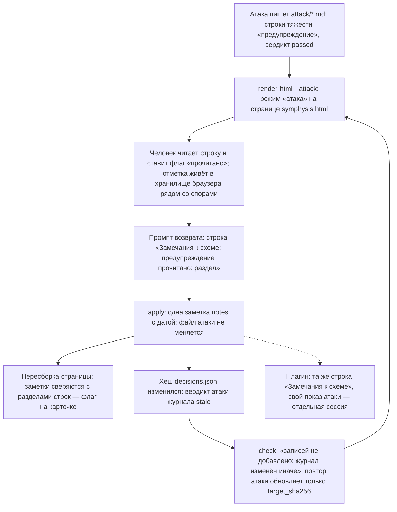

# Схема решения: attack-warning-read

Путь флага «прочитано» у строки `предупреждение` файла атаки: от страницы через промпт возврата
и `apply` в `notes[]` журнала и обратно на страницу; побочная ветка — хеш журнала и вердикт
`stale`. Узлы названы идентификаторами, на них ссылается поле `nodes` записей журнала.

