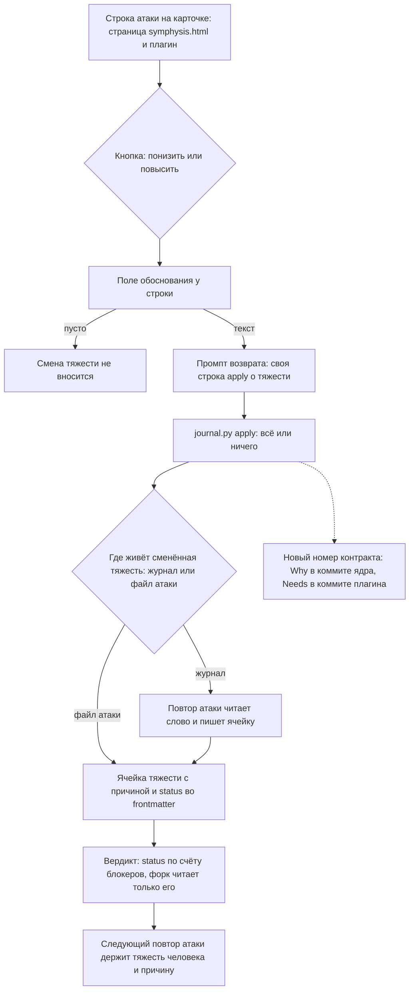

# Схема решения: attack-severity-buttons

Путь смены тяжести строки атаки словом человека: от кнопки и поля обоснования на карточке через
промпт возврата и свою строку `apply` к ячейке тяжести и вердикту, и дальше через повтор атаки,
который держит тяжесть человека. Развилка в середине — где живёт сменённая тяжесть. Узлы названы
идентификаторами, на них ссылается поле `nodes` записей журнала.

