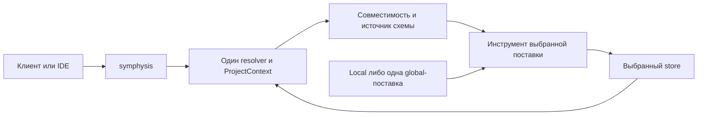

# Design

> Рендер из `decisions.json`, не править руками.

## Context

- F-01 Критерий готовности: «склонировать себе репозиторий store, установить symphysis, создать изменение и довести его до архивации» (слово владельца в чате, 2026-11-08).
  - openspec/changes/global-user-install/intent.md «- «склонировать себе репозиторий store, установить symphysis, создать изменение и довести его до архивации» (слово владельца в чате, 2026-11-08).»
- F-02 Критерий готовности: «при глобальной установке, человек, после клонирования сразу увидит всю раскладку скиллов как и его агент, и сможет продолжить работу» (слово владельца в чате, 2026-11-08).
  - openspec/changes/global-user-install/intent.md «- «при глобальной установке, человек, после клонирования сразу увидит всю раскладку скиллов как и его агент, и сможет продолжить работу» (слово владельца в чате, 2026-11-08).»
- F-04 Установщик сейчас задаёт проектные schema/tools и по умолчанию только .claude/skills; глобальный npm CLI сам этого не меняет
  - installer/lib/paths.js «export const DEFAULT_SKILLS_DIR = path.join(".claude", "skills");»
  - installer/lib/paths.js «toolsDir: path.join(root, ".symphysis"),»
- F-05 Скиллы ссылаются на проектные общие документы; перенос только SKILL.md оставит эти ссылки прежними
  - decisions/skills/symphysis-brainstorm/SKILL.md «- `&lt;каталог изменения&gt;` — `openspec/changes/&lt;имя&gt;/`; термины — `.symphysis/docs/terms.md`.»
- F-06 Старая база <root> привязана к расположению кода; синтетическая проба глобального runtime вернула общий родитель двух проектов
  - roots/roots.py «ROOT = Path(__file__).resolve().parent.parent»
  - openspec/changes/global-user-install/probes/runtime-map.md «Результат: все три `default_roots(journal_path=...)`, `default_roots(project_map, journal)`, `project_roots(project)` вернули общий `X:/codex-tmp/global-runtime-root-probe`, а не project-a. Это расширяет область чтения улик на соседние проекты. Логика доказана кодом и запуском, не прогнозом поведения модели.»
- F-07 OpenSpec имеет собственные store и слой пользовательских схем; локальная регистрация store не приезжает с клоном
  - openspec/changes/global-user-install/probes/store-probe.md «2. Для работы **из store cwd** регистрация не нужна для nearest root; для кода вне store нужны явный `--store`, pointer или осознанно выбранный defaultStore. Registry/defaultStore пользовательские и не приезжают с клоном.»
  - openspec/changes/global-user-install/probes/store-probe.md «| `schema which symphysis --json` | team-store, 1 → 0/user после user-schema → 0/project после локальной |»
- F-08 У клиентов различаются каталоги, приоритеты и форматы агентов; Claude skills preload нельзя механически копировать в Codex/OpenCode
  - openspec/changes/global-user-install/probes/client-matrix.md «| Codex | `~/.agents/skills/&lt;id&gt;/SKILL.md` / `.agents/skills/&lt;id&gt;/SKILL.md` | `~/.codex/agents/*.toml` / `.codex/agents/*.toml` | TOML: обязательны `name`, `description`, `developer_instructions` |»
  - openspec/changes/global-user-install/probes/client-matrix.md «| OpenCode V2 | `~/.config/opencode/skills/&lt;id&gt;/SKILL.md` / `.opencode/skills/&lt;id&gt;/SKILL.md` | `~/.config/opencode/agents/*.md` / `.opencode/agents/*.md` | Markdown: `description`, `mode: subagent`, `permissions`, `request` и др.; тело — `system`. Также agents в JSONC |»
  - openspec/changes/global-user-install/probes/client-matrix.md «- **Claude skills:** enterprise &gt; personal &gt; project при одинаковом имени; это прямо показано в таблице Resolve skills that share a name. Значит глобальная копия может перекрыть проектную, а не наоборот. Nested project skills могут оставаться доступными под квалифицированным именем; plugin skills namespaced. Symlinked skills поддерживаются, одинаковая цель загружается один раз. [Источник](https://code.claude.com/docs/en/skills#resolve-skills-that-share-a-name).»
- F-09 Хосты VS Code/OpenCode разделяют tools и cwd, но локальная копия имеет приоритет; миграция нужна и для discovery, и для выбора runtime
  - openspec/changes/global-user-install/probes/runtime-map.md «- VS Code `src/core/project.ts:26–39`: сначала PROJECT/.symphysis/tools, затем PROJECT/tools; только при отсутствии локальных — явная абсолютная настройка symphysis.toolsPath. Автоматического поиска user runtime нет. Старая локальная копия маскирует новый глобальный runtime даже при настройке.»
  - openspec/changes/global-user-install/probes/runtime-map.md «- Во всех вариантах оставить `.symphysis/viewer` и answers в выбранном проекте: общие tools не означают общие drafts/events. Не перенаправлять cwd в user runtime.»
- F-14 Нативный приоритет local/global различается у клиентов и даже между скиллами и агентами одного клиента
  - openspec/changes/global-user-install/probes/client-matrix.md «- **Claude skills:** enterprise &gt; personal &gt; project при одинаковом имени; это прямо показано в таблице Resolve skills that share a name. Значит глобальная копия может перекрыть проектную, а не наоборот. Nested project skills могут оставаться доступными под квалифицированным именем; plugin skills namespaced. Symlinked skills поддерживаются, одинаковая цель загружается один раз. [Источник](https://code.claude.com/docs/en/skills#resolve-skills-that-share-a-name).»
  - openspec/changes/global-user-install/probes/client-matrix.md «- **Claude agents:** managed &gt; CLI `--agents` &gt; project &gt; user &gt; plugin. Из вложенных project-каталогов выигрывает ближайший к cwd. Дубликаты одного name внутри одного дерева agents недетерминированы порядком чтения файлов; уникальность имени обязательна для предсказуемого выбора. [Источник](https://code.claude.com/docs/en/sub-agents#choose-the-subagent-scope).»
  - openspec/changes/global-user-install/probes/client-matrix.md «- **Codex skills:** обход `.agents/skills` от cwd до корня репозитория; одноимённые skills не объединяются, оба могут появиться в selector. Поэтому правило «проектная копия всегда перекрывает user» НЕ подтверждено. Поддерживаются symlinked skill folders; `agents/openai.yaml` — метаданные skill, не файл subagent. [Источник](https://learn.chatgpt.com/docs/build-skills#where-codex-loads-local-skills).»
  - openspec/changes/global-user-install/probes/client-matrix.md «- **OpenCode agents:** definitions merge: более поздние scalar заменяют ранние, request maps объединяются по ключу, permission rules дописываются. Это не атомарное замещение файла агента: при столкновении можно получить смесь. Mode по умолчанию primary, для driver явно нужен subagent. [Источник](https://opencode.ai/docs/agents/#merging).»
- F-17 [канон] Установка сохраняет границы собственных файлов: канон ИБ
  - openspec/changes/global-user-install/specs/user-installation/spec.md «### Requirement: Установка сохраняет границы собственных файлов»
- F-18 [канон] Расположение runtime не определяет рабочий store: канон ИБ
  - openspec/changes/global-user-install/specs/runtime-resolution/spec.md «### Requirement: Расположение runtime не определяет рабочий store»
- F-19 [канон] Поддерживаемые агенты исполняют скилл в нативном формате: канон ИБ
  - openspec/changes/global-user-install/specs/client-installation/spec.md «### Requirement: Поддерживаемые агенты исполняют скилл в нативном формате»
- F-25 Config CLI уже передаёт явный --project; fallback к ROOT относится к прямому вызову скрипта и не должен использоваться dispatcher
  - installer/bin/symphysis.js «const r = spawnTool(py, ["-X", "utf8", tool, "--project", project], { encoding: "utf8" });»
  - settings/symphysis_config.py «return ROOT»

### Состояние перед реализацией

Мотивация и границы поставки — в [proposal.md](proposal.md); исходные механизмы и фактические пробы — в [consequences.md](consequences.md) и `probes/`. Дельты содержат 35 требований и 73 сценария. Продуктовый код ещё не менялся. Проектная поставка сейчас объединяет runtime и данные в `.symphysis`; OpenSpec уже умеет отдельный store и пользовательские схемы, но не универсальный global init/update для этих трёх клиентов.

F-13 уточняет ранние F-03/F-12: local остаётся полноценным поддерживаемым режимом. Формулировки прежних вариантов о переходной старой раскладке не отменяют это уточнение. Приоритет local относится к resolver symphysis; нативные приоритеты клиентов не унифицируются.

В генерируемом ниже Decisions отражаются архитектурные развилки журнала. Исходы проб Specify F-15, F-16, F-20–F-24, F-26 уже закреплены сценариями и дополнительно сопоставлены механике в реализационной схеме. Они не теряются из-за того, что renderer показывает их иначе, чем обычные развилки. Канон F-17–F-19 рассматривается в [security.md](security.md); это не новые продуктовые вопросы, а ещё не выполненные проверки реализации.

Данный design задаёт инженерную схему для tasks. Он не объявляет готовыми глобальную установку, безопасность новой записи файлов или обнаружение агентами. Worktree, личный контекст разработчика, диск X и гейт имён — контур разработки; путь user-dir и клиентские roots — тиражируемый продукт.

## Goals / Non-Goals

- Определить один контракт выбора поставки и рабочего store для CLI, Python-инструментов, клиентских носителей и IDE-хостов.
- Связать владение файлами, проверку совместимости, нативную схему и план перехода так, чтобы tasks можно было исполнять без скрытых допущений описи.
- Сохранить самостоятельные local/global режимы и нативные форматы клиентов; проверять готовность каждого отдельно.
- Зафиксировать автономную доставку HTML-ресурсов, границы чтения/записи и необходимую приёмку.

Вне дизайна: изменение алгоритмов проектирования, принудительный отказ от local, поддержка смешанной native discovery, менеджер многих runtime-версий, политика SemVer из B-62 и самостоятельная реализация портов IDE/отдельного fork-symphysis-flow.

## Decisions

### F-03 Граница глобальной установки, уже принятая владельцем 2026-11-08

- **Выбрано:** A. Общий runtime, скиллы, поддерживаемые агентные тела и справка — на пользователя; в store остаются данные, настройки и необходимая инициализация. Это уже согласованный предмет ответа владельца, а не новый выбор.
- **Слово человека (2026-11-08):** «Да, соответствует.»
- **Обратимость:** дорого — Возврат к проектным копиям после реализации потребует обратной миграции клиентов, ресурсов и выбора runtime. Общие данные store в саму пользовательскую поставку не переносятся.
- **Улики вопроса:** openspec/changes/global-user-install/intent.md «&gt; весь общий исполняемый продукт на пользователя, в проектах только их состояние и необходимая инициализация»
- **Улики выбранного:** openspec/changes/global-user-install/intent.md «&gt; весь общий исполняемый продукт на пользователя, в проектах только их состояние и необходимая инициализация»

### F-10 Как глобальные скиллы и IDE находят и вызывают общий runtime, сохраняя рабочий корень store?

- **Выбрано:** A. Единая команда symphysis разрешает runtime/ресурсы и рабочий store; скиллы используют её. IDE получает путь той же выбранной поставки через общий resolver, прежние Python entrypoints можно сохранить. Цена — адаптация вызовов и discovery хостов; затем правило выбора живёт в одном месте.
- **Обратимость:** дорого — После изменения вызовов скиллов и IDE смена resolver потребует согласованного обновления клиентских адаптеров и сохранённых входов инструментов.
- **Улики вопроса:** decisions/skills/symphysis-brainstorm/SKILL.md «- `&lt;каталог изменения&gt;` — `openspec/changes/&lt;имя&gt;/`; термины — `.symphysis/docs/terms.md`.»
- **Улики вопроса:** roots/roots.py «ROOT = Path(__file__).resolve().parent.parent»
- **Улики вопроса:** openspec/changes/global-user-install/probes/runtime-map.md «Результат: все три `default_roots(journal_path=...)`, `default_roots(project_map, journal)`, `project_roots(project)` вернули общий `X:/codex-tmp/global-runtime-root-probe`, а не project-a. Это расширяет область чтения улик на соседние проекты. Логика доказана кодом и запуском, не прогнозом поведения модели.»
- **Улики выбранного:** openspec/changes/global-user-install/probes/runtime-map.md «| Единый `symphysis &lt;tool&gt;` dispatcher | Рекомендуемая основа: один resolver проекта/версии/ресурсов и короткие команды в skills; меняет вызовы skills и требует адаптации хостов. Можно сохранять прежние Python entrypoints как API для плагинов в global runtime. |»
- **Отвергнуто:** B. Скиллы и каждый хост сами читают манифест установки и вызывают Python-файлы общего runtime. Меньше новых CLI-подкоманд, но правила выбора cwd/store/версии придётся одинаково поддерживать в нескольких реализациях.
- **Отвергнуто:** C. Вшить абсолютные пути выбранного runtime в клиентские скиллы/агенты и настройки IDE при установке. Проще первый запуск, но после перемещения/обновления нужно согласованно перегенерировать все носители; старые копии могут ссылаться на другую поставку. — маловероятно: Жёсткие пути размножают точки обновления и хуже соответствуют общей переносимой поставке.

### F-11 Что происходит с уже существующими store при обновлении пользовательского runtime?

- **Выбрано:** A. Одна активная пользовательская поставка для первого выпуска. Store объявляет совместимость; при несовместимости check/команда отказывает с понятным действием, автоматической миграции данных нет. Совместимое обновление используется общим runtime. Нужна явная проверка совместимости, но не нужен менеджер нескольких версий.
- **Обратимость:** дорого — Смена одной активной поставки на несколько закреплённых версий потребует миграции привязок store и нового жизненного цикла runtime.
- **Улики вопроса:** openspec/changes/global-user-install/probes/runtime-map.md «- `openspec-run/openspec_run.py:70–85`: форк — SYMPHYSIS_OPENSPEC, затем PATH; cwd проекта передаётся запуску. Здесь нет согласованного выбора версии runtime/форка/схемы. Нужна явная политика совместимости, иначе обновление user runtime меняет старые проекты молча.»
- **Улики выбранного:** openspec/changes/global-user-install/probes/runtime-map.md «- `openspec-run/openspec_run.py:70–85`: форк — SYMPHYSIS_OPENSPEC, затем PATH; cwd проекта передаётся запуску. Здесь нет согласованного выбора версии runtime/форка/схемы. Нужна явная политика совместимости, иначе обновление user runtime меняет старые проекты молча.»
- **Отвергнуто:** B. Каждый store закрепляет точную версию, несколько версий runtime хранятся глобально рядом, resolver выбирает нужную. Лучше воспроизводимость разных store, но потребуются установка недостающей версии, удержание ресурсов и удаление неиспользуемых версий.
- **Отвергнуто:** C. Каждый store всегда получает последнюю глобально установленную версию без проверки совместимости и отдельной миграции. Минимум реализации, но обновление одного пользователя может изменить поведение всех его store без диагностики. — маловероятно: Без проверки совместимости нельзя надёжно отделить рабочий старый store от нуждающегося в миграции.

### F-12 Как перейти с прежних проектных скиллов и .symphysis/tools на глобальную поставку без смешения старых и новых исполнителей?

- **Выбрано:** A. Явная миграция выбранного store: сначала показать найденные собственные копии и конфликты, затем переключить их на общую поставку после подтверждения; изменённые пользователем файлы не перезаписывать автоматически. Новый store сразу использует global; поддержка старой раскладки ограничена диагностикой/переходом.
- **Обратимость:** дорого — После явной миграции возврат требует восстановления прежней проектной поставки и её клиентских файлов; данные store сохраняются отдельно.
- **Улики вопроса:** openspec/changes/global-user-install/probes/client-matrix.md «3. **Миграция должна быть явной:** искать старые symphysis skills/agents и сравнивать происхождение/версию перед записью. Удалять только свои отслеживаемые инсталлятором файлы; пользовательские custom bodies не перезаписывать. Причина — у клиентов несовместимые collision semantics, и «положили global» не означает «везде выбрана новая версия».»
- **Улики выбранного:** openspec/changes/global-user-install/probes/client-matrix.md «3. **Миграция должна быть явной:** искать старые symphysis skills/agents и сравнивать происхождение/версию перед записью. Удалять только свои отслеживаемые инсталлятором файлы; пользовательские custom bodies не перезаписывать. Причина — у клиентов несовместимые collision semantics, и «положили global» не означает «везде выбрана новая версия».»
- **Отвергнуто:** B. Старые проекты продолжают использовать прежние локальные копии до отдельного обновления; global работает только там, где локальная установка отсутствует. Меньше миграции сейчас, но человек может видеть другой набор скиллов/агентов в зависимости от клиента и конкретного проекта.
- **Отвергнуто:** C. Во время глобального install автоматически мигрировать все найденные store/проектные установки пользователя, заменяя только подтверждённые собственные неизменённые файлы; конфликты оставлять с диагностикой. Меньше ручных запусков, но намного шире область изменений и сложнее частичный отказ. — маловероятно: Для первой версии обход всех проектов увеличивает риск и не нужен сценарию установки в одном клонированном store.

### F-13 Global и local — два самостоятельных поддерживаемых режима; смешанная установка вне поддерживаемого сценария, local приоритетен

- **Выбрано:** A. Поддерживать отдельно полноценные global и project-local установки. В выбранном проекте используется один режим. При обнаружении обоих resolver symphysis выбирает local; автоматического объединения, переключения или исправления клиентских конфликтов нет. Владелец смешанной установки разрешает конфликты сам. Явная миграция F-12 остаётся действием пользователя для смены режима; local не объявляется устаревшим режимом.
- **Слово человека (2026-11-08):** «Важно отметить, что global инсталляция и проектная это две разные инсталляции. Мы поддерживаем работу у пользователя или одной или другой, а не обоих одновременно. Если пользователь установил сразу и global и local, то он сам разбирается с конфликтами, но приоритетная -- это local, на проект ( так по умолчанию происходит обнаружение скиллов и агентов, насколько я проверял).»
- **Обратимость:** обратимо — До реализации можно пересмотреть границы поддерживаемых режимов; после поставки потребуется изменить диагностику, resolver и документированную миграцию, сохранив пользовательские данные.
- **Улики вопроса:** openspec/changes/global-user-install/answers/2026-11-08-2.md «Важно отметить, что global инсталляция и проектная это две разные инсталляции. Мы поддерживаем работу у пользователя или одной или другой, а не обоих одновременно. Если пользователь установил сразу и global и local, то он сам разбирается с конфликтами, но приоритетная -- это local, на проект ( так по умолчанию происходит обнаружение скиллов и агентов, насколько я проверял).»
- **Улики выбранного:** openspec/changes/global-user-install/answers/2026-11-08-2.md «Важно отметить, что global инсталляция и проектная это две разные инсталляции. Мы поддерживаем работу у пользователя или одной или другой, а не обоих одновременно. Если пользователь установил сразу и global и local, то он сам разбирается с конфликтами, но приоритетная -- это local, на проект ( так по умолчанию происходит обнаружение скиллов и агентов, насколько я проверял).»

## Реализационная схема

Это техническая раскладка уже принятых F-03, F-10–F-13, F-15–F-16 и F-20–F-26. Имена новых команд и файлов ниже определяют интерфейс реализации; они не означают, что соответствующий код уже существует. Номер действующего IDE-контракта не резервируется.

### Поставка, bootstrap и состояние

Npm-пакет сохраняет команду `symphysis` и код bootstrap/инсталлятора с его зависимостями. Наличие этой команды в PATH само по себе не означает global-установку продукта. Bootstrap выбирает поставку, проверяет её совместимость и запускает её Python-инструменты; он не становится вторым экземпляром проектных данных.

| Часть | Local | Global |
| --- | --- | --- |
| Runtime и общие ресурсы | Существующая `.symphysis/tools`, `.symphysis/docs`, проектная схема и клиентские файлы | Одна активная копия payload в `<user-dir>/runtime`: `tools`, `docs`, `openspec/schemas/symphysis`, исходные `skills` и `agents` |
| Учёт собственных файлов | `.symphysis/install-manifest.json` | `<user-dir>/install-manifest.json`; сюда входят также управляемые пользовательские проекции схемы и клиентских носителей |
| Совместимость store | Действующая проектная поставка; global для её работы не требуется | Декларация `openspec/symphysis.json` в выбранном store |
| Личный состав и карта корней | `symphysis.yaml`, `.symphysis/tools/journal-roots.json` выбранного проекта | Те же проектные данные в выбранном store; папка `tools` с одной картой не означает local runtime |
| Журналы, ответы, страницы, черновики | В проекте/store | В выбранном store и его существующем хранилище черновиков; не в user runtime |

`<user-dir>`: абсолютный `SYMPHYSIS_HOME`, если задан; иначе `XDG_DATA_HOME/symphysis`, на Windows без XDG — `LOCALAPPDATA/symphysis`, на остальных системах — `~/.local/share/symphysis`. Если системная база отсутствует, вычисляется стандартный пользовательский каталог, а не cwd. Runtime ставится копированием проверенного payload: обновление npm-пакета не заменяет активные инструменты незаметно. Native user targets вычисляются отдельно от этого каталога; переменная symphysis не перенаправляет auth/state клиентов.

Manifest имеет `format: 1`, `scope`, идентификатор поколения, версию источника, контракт bootstrap/runtime и реестр собственных файлов с SHA-256, назначением и источником. Клиентские проекции записывают `clientId`, тип носителя и выбранный корень назначения. Личные абсолютные пути допустимы в этом локальном manifest, но не копируются в HTML, журнал решений или публикуемый отчёт. Ни содержимого карт корней, ни перечня всех store он не содержит.

Local определяется по действительному local manifest либо присутствию известных исполняемых файлов прежней поставки. Неполная local-копия остаётся найденной local-копией и получает диагностику; она не открывает fallback в global. Существование `.symphysis/`, личной карты или папки черновиков недостаточно для выбора local. Режим определяется для store, а не для каталога исходников с pointer.

### Команды и разрешение контекста

Сохраняются `install`, `check`, `config` и их действующие варианты `--project`, `--skills-dir`, `--agents-dir`. Установка без указания scope остаётся local. Добавляются `--scope local|global` и повторяемый `--client claude|codex|opencode`. При явных клиентах пути skills/agents независимы; старые path overrides применяются к одному выбранному клиенту. Несколько client IDs вместе с неоднозначными overrides — usage-ошибка до записи.

| Команда | Назначение |
| --- | --- |
| `symphysis install --scope global --client <id>` | Поставить/обновить общий продукт и пользовательские носители выбранных клиентов; не выбирать и не мигрировать store |
| `symphysis init --project <source> [--store <id>]` | Явно настроить выбранный store для уже установленной global-поставки, проверить config, применить схему/rules и записать декларацию совместимости |
| `symphysis resolve [--project <source>] [--store <id>] --json` | Только чтение: вернуть store, выбранную поставку, ресурсы, состояние совместимости и диагностику |
| `symphysis preflight [--project <source>] [--store <id>]` | Проверить готовность документированного пути до изменяющих действий; отказ не меняет store |
| `symphysis journal …`, `trace …`, `anchors …`, `help …` | Запустить соответствующий инструмент выбранной поставки; грамматика вложенного инструмента сохраняется |
| `symphysis resource <kind> <id>` | Прочитать именованный текстовый ресурс выбранной поставки; kind — skill, doc или template; допустимы только идентификаторы manifest, не произвольный путь или исполняемая команда |
| `symphysis openspec …` | Проверить контекст/совместимость/схему и затем выполнить нативную команду закреплённого форка в выбранном store |
| `symphysis migrate --to <scope> … --out <plan>` | Составить план перехода выбранного store; scope — local либо global; запись плана — только по явному `--out` |
| `symphysis migrate --apply-plan <plan> --confirm` | Повторно проверить план и выполнить подтверждённый переход |

Для новых dispatcher-команд общие `--project`/`--store` разбираются перед именем вложенного инструмента; их содержимое не смешивается с argv `journal`, `trace` и OpenSpec. Унаследованный синтаксис существующих верхнеуровневых команд остаётся допустимым. `--install-dir` у справки сохраняет только прежнее назначение поиска скиллов, не выбора runtime.

Global install не принимает `--project` как скрытое поручение init; такой конфликт параметров — usage-ошибка. Его overrides клиентских каталогов должны быть абсолютными; относительные legacy overrides остаются у local. Селекторы store во вложенном вызове OpenSpec или путь адресуемого журнала сверяются с ProjectContext **до** preflight: нельзя проверить один store и затем записать другой через поздний аргумент.

Если в выбранном store уже обнаружен local runtime, global-init не превращается в неявную смену режима: он называет необходимость явного `migrate --to global` с preview. Init предназначен для настройки global-store без local-поставки. Любая заданная пользовательская база установки/config-home проверяется как абсолютный путь; ошибочное относительное значение не разрешается от случайного cwd.

Единственный алгоритм выбора живёт в Node-модуле `installer/lib/runtime-resolver.js`:

1. Получить planning root через проверенный JSON-контракт `openspec context`, соблюдая нативные `--store`, pointer и nearest/default store. Самостоятельный второй поиск store по родителям не создаётся. Ошибка форка/его контракта — диагностика, не догадка по cwd. Для операций по журналу его `openspec/changes/[archive/]…` определяет адресуемый store; несовпадение с явным параметром даёт отказ.
2. Найти local-поставку в этом root; иначе — активный user runtime. Не объединять содержимое. Сформировать один `ProjectContext`: store root, исходный cwd, выбранный scope, runtime/tools/docs/schema root, клиентские targets, личная карта корней и поколение поставки.
3. Проверить формат manifest, требуемые ресурсы и контракт bootstrap/runtime. При global проверить декларацию store и фактическую схему OpenSpec. Любой отказ содержит действие пользователя; на другую поставку алгоритм не переключается.
4. Передать дочернему процессу явный контекст и `cwd=storeRoot`. Аргументы путей журнала/ответов нормализовать относительно их документированной базы до смены cwd. Команда по журналу из другого cwd сохраняет именно store журнала.

Python-модуль `runtime/runtime_context.py` потребляет проверяемый сериализованный контекст dispatcher и сверяет пути/поколение с локальным manifest; он не реализует второй поиск global/local. У нового global entrypoint без контекста начальный stdlib-only bootstrap до загрузки runtime imports передаёт запуск соответствующему `symphysis` dispatcher с прежними argv и завершает внешний процесс его кодом. Только dispatcher после preflight запускает инструмент с действительным контекстом и удерживаемой lease; проверка lease предотвращает цикл повторного делегирования. Один `resolve` не разрешает исполнение инструмента напрямую. Для исходников ядра и прежних local entrypoints остаётся отдельный прежний вход с явными roots/путями: он не объявляется lease-защищённым global-вызовом и не становится требованием к пользователю продукта. Сами настройки читает по-прежнему только `symphysis_config.py`, с явным `--project=storeRoot` (F-25).

JSON `resolve` имеет собственный `format: 1`, `status`, `store`, `scope`, `runtime`, `resources`, `compatibility`, `clients`, `diagnostics`. Абсолютные пути в нём адресованы локальному вызывающему хосту и не публикуются. Read-only `resolve` может вернуть выбранную поставку вместе с `status=blocked`; это не разрешение выполнить работу. Exit 0 означает готовность, 2 — usage/ожидаемый отказ установки или совместимости, 1 — внутренняя ошибка. Низкоуровневые коды `journal.py`/`trace_graph.py` не перенумеровываются: dispatcher возвращает их после успешного preflight.

### Декларация совместимости и схема

`openspec/symphysis.json` — небольшой переносимый файл store: `format: 1`, `runtimeApi: 1`, `schemaApi: 1`. Он не содержит пути установки, выбранного локального клиента, версии npm или личных настроек. Первая реализация понимает явные целые номера контрактов; отсутствующий файл, неизвестный формат и несовпадение номера не считаются совместимостью. Изменять их может только явная init/миграция с предварительной проверкой. Это формат технической совместимости, а не новая политика SemVer пакета из B-62.

У обычной команды и preflight отсутствие декларации даёт отказ F-15. Управляющие `init` и `migrate` вправе подготовить декларацию как своё явное действие; им всё равно нужны действительная поставка, проверенные цели и пригодный planning config. `check` сообщает несовместимость и не чинит файл. Уже работающий local не требует global-декларации ради появления нового режима.

Для global пользовательская схема OpenSpec — управляемая проекция канонической схемы из активного runtime в user schemas dir, вычисленный по правилам закреплённого форка. Она имеет тот же состав и байты по manifest. Для local используется проектная схема. Preflight сначала определяет **эффективную схему адресуемой команды/change** средствами закреплённого форка: учитываются metadata существующего изменения, planning config и явный `--schema` в native argv. Для new без существующего change проверяются явный override либо default store. Нельзя проверить `symphysis`, а затем исполнить другую схему из позднего аргумента. Имя и контракт эффективной схемы должны входить в manifest выбранной поставки; неизвестная схема в документированном symphysis-пути получает диагностику, не неявное переключение. Существующий change не конвертируется в другую схему одним молчаливым override.

Для полученного имени `schema which <effective-name> --json` вызывается из **store cwd**, а не pointer-repo; сравнивается фактический каталог и manifest схемы, одного `source=user` недостаточно. Остаточная проектная или чужая пользовательская схема вызывает F-24: источник назван, исполнение не продолжается, файл автоматически не удаляется. Несогласованные schema/rules/operations не маскируются новой декларацией. Это граница охраняемого symphysis-пути, не запрет на чужие схемы в самостоятельном OpenSpec.

Декларация не закрепляет отдельную версию runtime за store. Совместимое global-обновление меняет общие ресурсы для всех использующих их store без обхода и переписывания этих store. Неизвестная совместимость требует действия пользователя; скрытого подбора старого runtime нет.

Исполняемый форк по-прежнему находится через `SYMPHYSIS_OPENSPEC` либо PATH, но перед работой сверяется с openspec pin/поддерживаемым контрактом выбранной поставки. Наличие Node/Python и правильного форка проверяется отдельно от наличия payload. Install не ставит системные зависимости или другую версию форка молча: недостающая зависимость оставляет проверку неполной и даёт явную команду пользователю. Изменение пина/вендора ведётся согласованно с отдельной сессией форка.

### Владение файлами, установка и обновление

Один общий planner обслуживает оба scope; раскладка целей различается. До записи он читает только явные/управляемые цели, проверяет payload, native targets, существующий manifest, типы `rules`/`operations`/`guidance`, конфликты и реальные пути. Неверная структура planning config даёт F-26 до записи любого проектного config или декларации.

Для существующего файла классификация такова: точные ожидаемые байты без записи; прежние собственные неизменённые байты — разрешённое обновление; правка пользователя/чужой файл/неизвестное происхождение — конфликт с сохранением файла. `--force` не является правом затирать конфликт: он не заменяет ownership и сравнение байтов. Старые файлы без manifest не объявляются собственными только по префиксу имени; известных неизменённых предшественников можно включить в явно подтверждаемый план, неизвестные требуют ручного разрешения.

Личные настройки, карта корней, журналы и черновики не входят в реестр **заменяемых** ресурсов, даже если начальный образец создал установщик. Planning config также не подменяется целым файлом из payload: явный init планирует структурное добавление schema/rules/operations с сохранением посторонних полей и комментариев. Отсутствующий ключ допускает создание своего значения, неожиданная структура существующего — отказ F-26. Повторная проверка исходных байтов защищает и этот planned merge от гонки; она не превращает пользовательский config в собственный файл поставки.

Global-профиль содержит только одну активную копию. Установка готовит staging рядом с назначением, проверяет состав и хеши и публикует поколение с manifest последним. Управляемые native/user-schema проекции обновляются из того же поколения; при изменении общего runtime рассматриваются все ранее управляемые проекции этого профиля, а не найденные по всему компьютеру каталоги клиентов. Новый client ID добавляется явно. Частично обновлённый профиль не объявляется готовым: блокируется preflight с диагностикой завершения/восстановления установки. Это не менеджер закреплённых версий; backup/staging — временное состояние транзакции.

Установщик имеет exclusive management lock; выполняемые dispatcher-команды регистрируют короткоживущие reader leases поколения. Reader проверяет отсутствие writer lock до и после регистрации lease; writer создаёт lock до проверки leases и при живом читателе отказывает как busy. Поэтому обновление не меняет файлы под уже запущенным инструментом. Чужие блокировки не снимаются автоматически; аварийная собственная транзакция восстанавливается явным `install --recover` после проверки её записей, целей и отсутствия живого владельца. Перед удалением временного дерева проверяются его принадлежность и все reparse-компоненты; чужие ссылки и цели не обходятся рекурсивно.

Lease владеет процесс dispatcher до окончания дочернего инструмента, в том числе при IDE-вызове. Discovery-запрос `resolve` не удерживает её для будущего запуска: IDE обращается к dispatcher вновь, а не запускает найденный Python сама. Авария/отмена child освобождает lease в контролируемом завершении; оставшаяся после аварии lease не удаляется по одному лишь старому PID без проверки живого владельца. Тест update во время длительного IDE/direct-global вызова должен подтверждать отказ writer, а не только повторный resolve до старта.

### Клиентские адаптеры и охраняемые workflow

`clientId` задаётся явно, не выводится из `.agents`, `.claude` или пути `skills`. Descriptor содержит независимые roots skills/agents/commands, нативный renderer, профиль необходимых workflow и правила проверки. Клиентские config-home overrides учитываются при вычислении этих roots; root symphysis не меняет HOME, авторизацию, provider/MCP, модель или доверие проекта.

| Клиент | Global targets по умолчанию | Local targets | Агент и workflow |
| --- | --- | --- | --- |
| Claude Code | Claude config root `/skills`, `/agents`, `/commands/opsx` | `.claude/skills`, `.claude/agents`, `.claude/commands/opsx` | Markdown/YAML; нативный preload `skills` плюс явная проверка доступности; commands либо skills закреплённого профиля |
| Codex | `~/.agents/skills`; Codex config root `/agents` | `.agents/skills`; `.codex/agents` | TOML с `name`, `description`, `developer_instructions`; workflow — invocable skills, без выдуманной папки slash commands |
| OpenCode V2 | OpenCode config root `/skills`, `/agents`, `/commands` | `.opencode/skills`, `.opencode/agents`, `.opencode/commands` | Native Markdown, `mode: subagent`, разрешённые V2 fields; commands `opsx-<id>.md` либо skills |

Для Codex наличие `CODEX_HOME` не считается переносом пользовательского `~/.agents/skills`: targets вычисляются отдельно. Формат standalone agents и наследование прав подтверждены [официальной документацией OpenAI](https://learn.chatgpt.com/docs/agent-configuration/subagents); размещение skills — [Build skills](https://learn.chatgpt.com/docs/build-skills), корень config/state — [Environment variables](https://learn.chatgpt.com/docs/config-file/environment-variables). Дата сверки: 2026-11-09. Codex/OpenCode driver явно получает нужное тело skill через нативный механизм либо dispatcher resource lookup; Claude YAML `skills` не переносится как фиктивный preload. Модель и reasoning не задаются поставкой без отдельного выбора пользователя, полномочия не расширяются.

Npm-сборка symphysis получает доверенные шаблоны из **закреплённого артефакта** форка, применяет преобразование до форматирования носителя и кладёт результат в payload клиента. Проверенная исходная основа — `getSkillTemplates`, `getCommandContents`, `generateSkillContent(transformInstructions)` и `generateCommand`. Это внутренний сборочный адаптер к конкретному pin, не обещанный публичный API OpenSpec и не флаг `init/update --global`. Несовпадение ожидаемого export/формата прекращает сборку; runtime не импортирует случайный соседний checkout форка.

Производные охраняемые носители принадлежат symphysis и учитываются его manifest, с атрибуцией доноров. До первого Write/Edit/изменяющего действия их начальная инструкция требует успешный `symphysis preflight`; нативные CLI-примеры и команды в их теле идут через `symphysis openspec`. `allowed-tools`/разрешения оболочки адаптируются к этому префиксу, а не расширяются до произвольного shell. Профиль содержит все workflow документированного пути, обязательно `new`, `continue`, `apply`, `sync`, `archive`; текущие дополнительные workflow профиля сохраняются как выбранная поставка. Опциональные шаги symphysis не превращаются в обязательные из-за этой генерации.

Существующие носители OpenSpec не перезаписываются по сходству имени: неизвестный файл — конфликт. Известная неизменённая предыдущая генерация может перейти под управление только явным подтверждённым планом. `symphysis openspec init/update` выполняет управляющую операцию только через этот planner и затем восстанавливает согласованные охраняемые проекции, не запускает неограниченную перегенерацию в обход ownership. Сторонний прямой `openspec update` может изменить управляемые носители: следующий `check` назовёт расхождение; такая изменённая установка не считается прошедшей приёмку. Произвольные ручные команды OpenSpec вне документированного пути не перехватываются.

F-23 имеет две части проверки: dispatcher детерминированно отказывает несовместимому store до запуска своего инструмента; выполнение начальной инструкции клиентским агентом подтверждается журналом реального прогона до первой записи. Текст в SKILL.md не выдаётся за OS-барьер против произвольного поведения модели. Поэтому готовность клиента нельзя объявить только по созданным файлам.

У каждого выбранного клиента отдельный результат: целостность поставки, наличие нативных носителей, наличие необходимых workflow, подтверждение discovery/выполнения в свежей сессии. Не выполненная сессионная проверка имеет состояние «не подтверждено», а не `ready`. Наличие continue у одного клиента не скрывает отсутствие у второго (F-21). Нативные приоритеты/коллизии local/global остаются правилами клиента и ответственностью владельца смешанной установки.

### Ресурсы, карта корней, справка и HTML

Все Python-потребители получают один ProjectContext. Личная карта по умолчанию берётся из выбранного store; отсутствующая карта даёт только его корень, без придуманных префиксов. Для старой проектной карты `<root>` сохраняет проектную базу `.symphysis`, даже если такой каталог содержит лишь личные данные, а `<root>/..` по-прежнему означает store. У явного `--roots` проектная база также передаётся контекстом, не берётся от `__file__`. Исходный dev-контур сохраняет своё явное разрешение. Неверная карта даёт видимый сигнал/отказ соответствующего инструмента; runtime-каталог не подставляется как запасной проект. Проверка `..`, абсолютного хвоста и конечного realpath внутри выбранного корня остаётся общей для journal, справки, графа и ссылок (F-20).

`step_help` читает тексты и версию выбранной поставки и рассчитывает состояние по файлам store. Поиск ссылок на skills сохраняет проектный приоритет; без `--install-dir` следующий источник — только выбранная поставка. Явный install-dir меняет поиск ссылок, не исполнителя или store. Команда пересборки страницы формируется через dispatcher и указывает store журнала; `.symphysis/tools/journal.py` не появляется как выдуманный fallback для global.

Для global `render-html` делает автономную страницу: текст найденных собственных скиллов включается в payload как данные и показывается через textContent/экранирование; mermaid включается как base64 доверенных байтов выбранного ресурса с лицензией. Loader декодирует UTF-8 и создаёт inline script **только** из этого проверенного библиотечного поля; произвольный текст журнала, brief или скилла не поступает в исполняемый слот. CSP продолжает запрещать сеть, `eval` и удалённые скрипты; нового `blob:`/HTTP источника не требуется. В HTML нет абсолютного пути user runtime, а расположение на другом диске не требует относительной ссылки (F-22). Для local остаётся прежний относительный loader и прежний текстовый fallback отсутствующего mermaid; ресурс global туда не подмешивается.

Это производный артефакт просмотра, не проектная установка runtime и не перенос данных store в общую поставку. Страница станет больше на размер mermaid; это цена автономности при запрете сети и абсолютного пути. Ссылки на личные проектные файлы продолжают использовать допустимую карту; произвольные пользовательские документы в HTML автоматически не копируются. При отсутствии либо повреждении выбранного ресурса показывается диагностика, другая поставка не подставляется.

Ключи черновиков и cursor остаются у конкретного журнала/store; обновление библиотеки не меняет pathname-идентичность страницы и не очищает невнесённое слово. Переезд самого store не получает новой гарантии переноса browser localStorage. Хосты сохраняют существующую проектную принадлежность черновиков; resolver меняет их источник инструментов, а не адрес данных.

### Как плагин находит bootstrap

Наличие общего resolver не решает его первоначальное обнаружение. Плагин не получает путь к dispatcher из ещё не найденного runtime и не начинает со сканирования user-dir. Цепочка такова: **окружение IDE → bootstrap symphysis → resolve → выбранные store/runtime → запуск инструмента через тот же dispatcher**.

1. Явная настройка плагина `symphysis.commandPath` указывает абсолютный путь к bootstrap. Без неё плагин ищет команду `symphysis` в PATH **процесса, где будет исполнен инструмент**. Не используются автоматический поиск в cwd, workspace `node_modules/.bin`, папки соседних проектов или эвристики по npm prefix.
2. Launcher возвращает абсолютную команду и массив argv. Windows npm `.cmd`/`.bat` запускаются адаптером с проверенным экранированием и запретом неявного поиска executable в cwd; командная строка не собирается из сырых значений проекта. Явный JS-entrypoint требует Node: абсолютный `symphysis.nodePath` либо безопасный поиск node в том же PATH. Electron/IDE executable не выдаётся за Node. Неверная явная настройка называется ошибкой и не игнорируется ради другого CLI.
3. Плагин вызывает найденный bootstrap `resolve --project <source> --json`. На границе проверяются timeout, код выхода, форма/версия resolver JSON, выбранный store, поколение и журналовый контракт. Наличие исполняемого файла или успешный `--version` ещё не означает готовность global runtime. Отсутствующий CLI, старый CLI без resolve, неподготовленная поставка и несовместимый store — разные диагностические исходы.
4. При успехе journal/help/apply/rebuild идут через **тот же launcher и dispatcher**, а не через самостоятельно найденный `journal.py`. Runtime выбирается resolver, local имеет его согласованный приоритет, lease держится до выхода дочернего инструмента. `toolsPath` не становится настройкой пути к CLI и не даёт обхода этой цепочки.
5. Плагин не считает PATH активного терминала доказательством PATH своего процесса. При недоступной команде он сообщает способ указать bootstrap; после установки/изменения настройки повторный refresh заново делает discovery. Отрицательный результат не кэшируется навсегда. При смене поколения обновляется отображаемая готовность, а перед операцией выполняется новое разрешение.

В GUI без нужного PATH поддерживаемый выход — явные commandPath/nodePath, а не копирование runtime в проект ради поиска. Эти настройки описываются в справке соответствующего плагина и GUIDE; настройки и исполняемые пути не записываются в store и не переносятся между хостами автоматически. Само ядро и CLI/skills-флоу не требуют установленного IDE-плагина; плагин является потребителем контракта ядра.

### Зависимости трёх плагинов и граница выпуска

Сверка исходников 2026-11-09: VS Code `3838163`, OpenCode `33b8f91`, GIGA IDE `a483d62`. У всех пока lookup проектных tools либо ручного toolsPath и прямой запуск Python. Новое автоматическое bootstrap discovery и dispatcher path **не реализованы** в этих версиях; ручной toolsPath не доказывает соответствие новым проверкам совместимости/leases. Подробная опора — `probes/plugin-discovery-audit.md`.

| Потребитель | Изменения для global | Условие готовности |
| --- | --- | --- |
| VS Code | Launcher bootstrap, resolver handshake, смена CoreEnv/runPython на dispatcher adapter, обновление справки и refresh | Contract tests с новой поставкой и установленная extension на global-only store |
| OpenCode IDE/plugin | Тот же discovery/handshake и dispatcher adapter в host, обновление refresh вместо зависимости только от проектных tools watchers | Contract tests host и фактический запуск на global-only store |
| GIGA IDE | Bootstrap launcher в Core, resolver вместо ручного environment lookup, запуски/справка/refresh через dispatcher | Проверки Kotlin Core и установленная ZIP-сборка на global-only store |

Зависимость направлена от этих трёх потребителей к новому discovery/launch контракту ядра. В tasks должны быть отдельные пункты ядра и каждого потребителя с координацией их коммитов/Needs. Готовый resolver ядра не закрывает plugin-часть B-67. Для цели первого выпуска с тремя IDE нужны все три приёмки; достижимость нового ядра из main сама по себе их не заменяет. Отдельный merge ядра может предшествовать портам, но не объявлению их global-поддержки.

Обязательная межрепозиторная матрица: global-only store без `.symphysis/tools/journal.py` и без toolsPath; независимый local-only; наличие обоих с проверкой local-приоритета resolver и диагностики; пустой/изменённый PATH IDE с явным bootstrap; старый/неверный CLI; несовместимый store; два store с одноимённым change; обновление поколения при открытой IDE; отсутствие записи до успешного handshake/preflight. На global-only проверяются не только view-json, но справка, apply и rebuild с сохранением данных store. Нужны установленные сборки плагинов, а не только unit-моки launcher.

### Модули, хосты и проверка результата

| Область | Изменение реализации |
| --- | --- |
| `installer/lib` | Общие runtime resolver, ProjectContext, planner/manifest, независимые client descriptors, проверка совместимости, миграция и управление поколением |
| `installer/bin/symphysis.js` | CLI bootstrap и явные dispatcher-команды; существующие инструменты получают неизменённую вложенную грамматику |
| `runtime/runtime_context.py`, `roots`, `settings`, `step-help`, `cli` | Потребление выбранного контекста; проектная карта/настройки, выбранные ресурсы, корректная команда пересборки |
| `viewer` | Автономные global-ресурсы и безопасные текстовые тела; сохранение local fallback и идентичности черновика |
| `installer/scripts` и стенды | Сборка клиентских производных из pin, включение нового Python-модуля и ресурсов во все списки; payload генерируется, руками не редактируется |
| Схема, общие docs, навыки/водители | Команды dispatcher и ресурсные обращения вместо предполагаемой проектной копии; перед реальной правкой тел — канон и writing-skill-bodies |
| Плагины VS Code, GIGA IDE, OpenCode | Вызвать общий `resolve`, сохранить store cwd и данные черновиков, повторить разрешение при смене поколения; отказаться от своих эвристик расположения runtime |

Хост получает resolver JSON для discovery/показа, а каждый фактический инструмент запускает через dispatcher в указанном store, передавая адресуемые аргументы; запуск Python напрямую после resolve не является новым поддерживаемым host-путём. Dispatcher повторно проверяет поколение/совместимость и удерживает lease до завершения child, существующая вложенная грамматика journal/trace сохраняется. Существующая настройка toolsPath не превращается в право обойти resolver: явная внешняя поставка либо идентифицируется в его протоколе, либо получает диагностику. Новый discovery-интерфейс и фактические изменения текущего контракта согласуются с портами; `CONTRACT` берётся из main и увеличивается по repo-contract при реализации/мерже, а не по числу этого design. До обновления хоста он не объявляется поддерживающим global лишь потому, что новые файлы стоят на машине.

| Принятая норма | Проверка реализации |
| --- | --- |
| F-10/F-13 | CLI и все хосты выбирают одну поставку; local-only работает без global, global-only — без проектного runtime; смешанный случай проверяет только выбор/диагностику |
| F-11/F-15 | Два совместимых store переживают одно обновление; несовместимая/отсутствующая/неизвестная декларация отказывает без записи и без подбора другой версии |
| F-12/F-16 | Preview/подтверждение выбранного store; изменение файла после preview отвергает план, чужие данные и второй store сохранены |
| F-20 | Разные карты `src/` и прежний `<root>` у двух store проверяются journal, справкой и freeze, без расширения к runtime |
| F-21 | Для каждого клиента проверяются носители и нужные workflow; неполный второй клиент не получает успех первого |
| F-22 | HTML на другом диске даёт рисунок и тело skill без сети/абсолютного пути; в local проверяется прежняя деградация |
| F-23 | Неготовый store в native new/continue не изменяется; фактический лог клиента показывает preflight раньше первой записи |
| F-24 | Эффективная схема metadata/argv и её фактический источник проверяются из store cwd; остаточная проектная либо чужая user-схема сохраняется при отказе |
| F-26 | Неверные map/sequence planning config останавливают init до записи; корректные пользовательские поля сохраняются |

Тесты будущей реализации запускаются в изолированных user/client roots. После точечных проверок модулей обязательны стенды установленной копии и инсталлятора; реальная клиентская приёмка использует безопасный учебный store и явно разрешённый запуск клиента. Глобальная установка на рабочую машину не является тестовой фикстурой. Полный product flow и роли считаются принятыми только после наблюдённого выполнения; текущие пробы подтверждают исходные механизмы, не готовую реализацию.

CLI help, `steps.md`/`step_help.py` и GUIDE должны описать все добавленные команды, scope/target overrides, `SYMPHYSIS_HOME`, состояния проверки и восстановление установки. В справку не переносятся личные значения путей или контекст разработчика. Этот перечень входит в приёмку реализации вместе с B-61/B-65, а не остаётся скрытым интерфейсом installer.

## Risks / Trade-offs

- [Risk] - `CoreEnv` (`src/core/core.ts:12–17`) уже разделяет tools и cwd проекта. Python вызывается с cwd проекта, аргументы журнала/ответа считаются от него (:36,55–65). Можно сохранить argv/JSON view-json/apply/check и заменить только lookup/источник tools. (F-10, отвергнут B: openspec/changes/global-user-install/probes/runtime-map.md) → Mitigation: решение A
- [Risk] - `&lt;каталог изменения&gt;` — `openspec/changes/&lt;имя&gt;/`; термины — `.symphysis/docs/terms.md`. (F-10, отвергнут C: decisions/skills/symphysis-brainstorm/SKILL.md) → Mitigation: решение A
- [Risk] - `openspec-run/openspec_run.py:70–85`: форк — SYMPHYSIS_OPENSPEC, затем PATH; cwd проекта передаётся запуску. Здесь нет согласованного выбора версии runtime/форка/схемы. Нужна явная политика совместимости, иначе обновление user runtime меняет старые проекты молча. (F-11, отвергнут B: openspec/changes/global-user-install/probes/runtime-map.md) → Mitigation: решение A
- [Risk] - `openspec-run/openspec_run.py:70–85`: форк — SYMPHYSIS_OPENSPEC, затем PATH; cwd проекта передаётся запуску. Здесь нет согласованного выбора версии runtime/форка/схемы. Нужна явная политика совместимости, иначе обновление user runtime меняет старые проекты молча. (F-11, отвергнут C: openspec/changes/global-user-install/probes/runtime-map.md) → Mitigation: решение A
- [Risk] 3. **Миграция должна быть явной:** искать старые symphysis skills/agents и сравнивать происхождение/версию перед записью. Удалять только свои отслеживаемые инсталлятором файлы; пользовательские custom bodies не перезаписывать. Причина — у клиентов несовместимые collision semantics, и «положили global» не означает «везде выбрана новая версия». (F-12, отвергнут B: openspec/changes/global-user-install/probes/client-matrix.md) → Mitigation: решение A
- [Risk] 3. **Миграция должна быть явной:** искать старые symphysis skills/agents и сравнивать происхождение/версию перед записью. Удалять только свои отслеживаемые инсталлятором файлы; пользовательские custom bodies не перезаписывать. Причина — у клиентов несовместимые collision semantics, и «положили global» не означает «везде выбрана новая версия». (F-12, отвергнут C: openspec/changes/global-user-install/probes/client-matrix.md) → Mitigation: решение A

## Migration Plan

1. Ввести resolver/контекст и режим local с прежней раскладкой, проверить установленные копии и исправить путь справки/ресурсов без требования global. Добавить manifest новым установкам; legacy-копии распознавать как local, а не пропускать ради user runtime.
2. Собрать global payload и нативные проекции из закреплённого форка. Прогнать planner без записи на безопасных фикстурах: чужие файлы, пользовательские правки, неверный config, разные диски и reparse. Проверить отдельные targets Codex skills/agents и реальный command surface OpenCode.
3. Поставить global в изолированный user-dir и настроить клонированный учебный store явным init. Получить отказ без декларации, затем успешный путь с декларацией. Не изменять реальную пользовательскую установку ради этой проверки.
4. Перевести выбранный local-store по preview: план содержит источник, назначение, поколения/хеши и конкретные операции с собственными файлами. Удаляются только подтверждённые прежние собственные копии; неизвестные или изменённые блокируют соответствующую операцию. Конфликт структуры config останавливает план до записи. Данные/ответы/карта сохраняются, вторые store не обходятся.
5. Перед apply повторно проверить байты, происхождение, реальные пути и поколения; расхождение аннулирует подтверждение (F-16), требуется новый preview. После файловых операций проверить источник схемы и клиентские носители, затем опубликовать декларацию/receipt завершённого перехода. Частичный отказ не называется завершённой миграцией.
6. Обновить три IDE-хоста по общему контракту и выполнить приёмку каждого поддерживаемого клиентского пути от intent до archive. Пока соответствующий хост не обновлён и не проверен, его global-поддержка не объявляется.

Возврат global → local — такой же явный план установки полной проектной поставки. Он не удаляет общую поставку и пользовательские носители, которые могут требоваться другим store. Если глобальные носители того же клиента остаются обнаруживаемыми, план отдельно называет смешанную discovery и не выдаёт её за разрешённую; её устранение остаётся явным действием пользователя по F-13.

Откат обновления — повторная явная установка прежнего пакета/payload при совместимых контрактах и повторной проверке owned hashes. Неизвестные/изменённые файлы не откатываются поверх пользователя. Временный backup применяется только для восстановления незавершённой собственной транзакции. Отмены уже сделанных изменений store обновление runtime не обещает; incompatible downgrade отказывает, пока пользователь явно не согласует проектную совместимость. Ни rollback runtime, ни переход одного store не мигрирует все store пользователя.

## Open Questions

- F-17 → ИБ: «Валидация целевых путей, reparse-точек и области собственных файлов при записи — канон ИБ; покрывается чек-листом security.md; запрет не чеканится»
- F-18 → ИБ: «Изоляция корней чтения и записи store, обходы ../ и символьных ссылок — канон ИБ; покрывается чек-листом security.md; запрет не чеканится»
- F-19 → ИБ: «Права и инструменты нативного агента, инъекции в brief и отсутствие скрытого расширения полномочий — канон ИБ; покрывается чек-листом security.md; запрет не чеканится»
